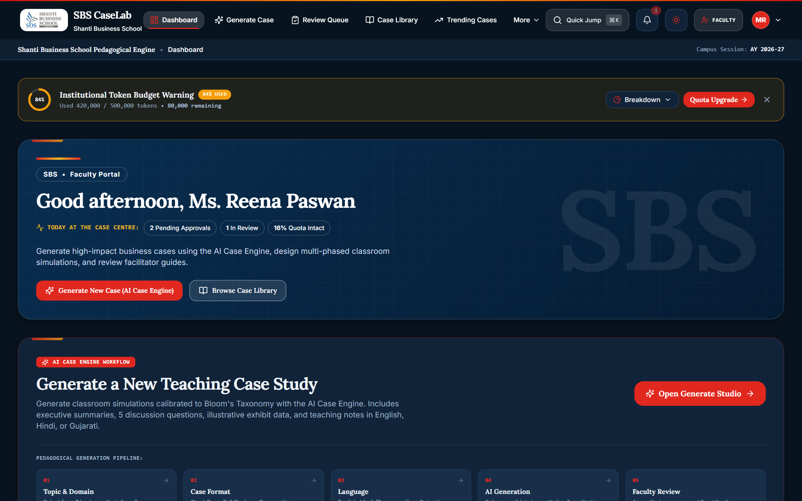
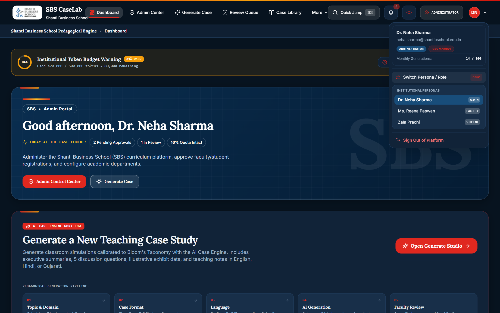
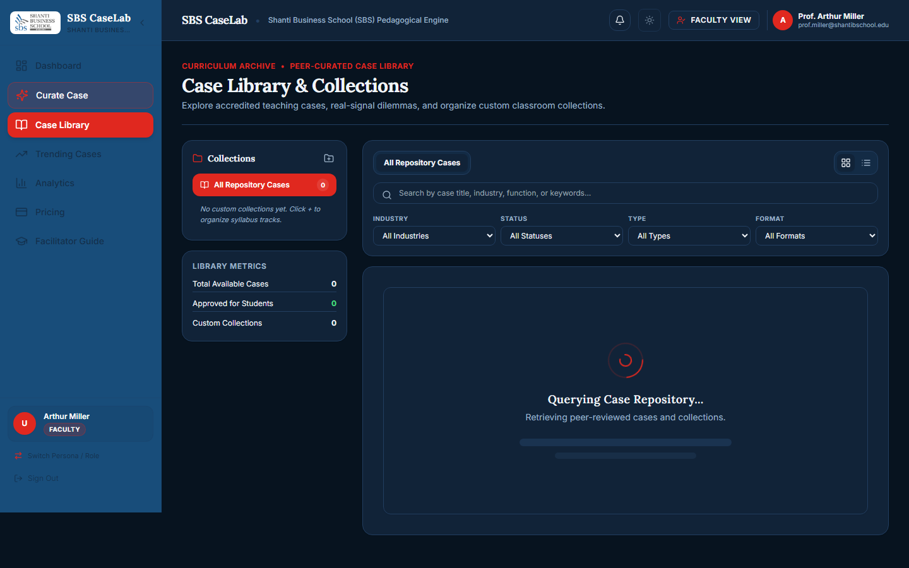
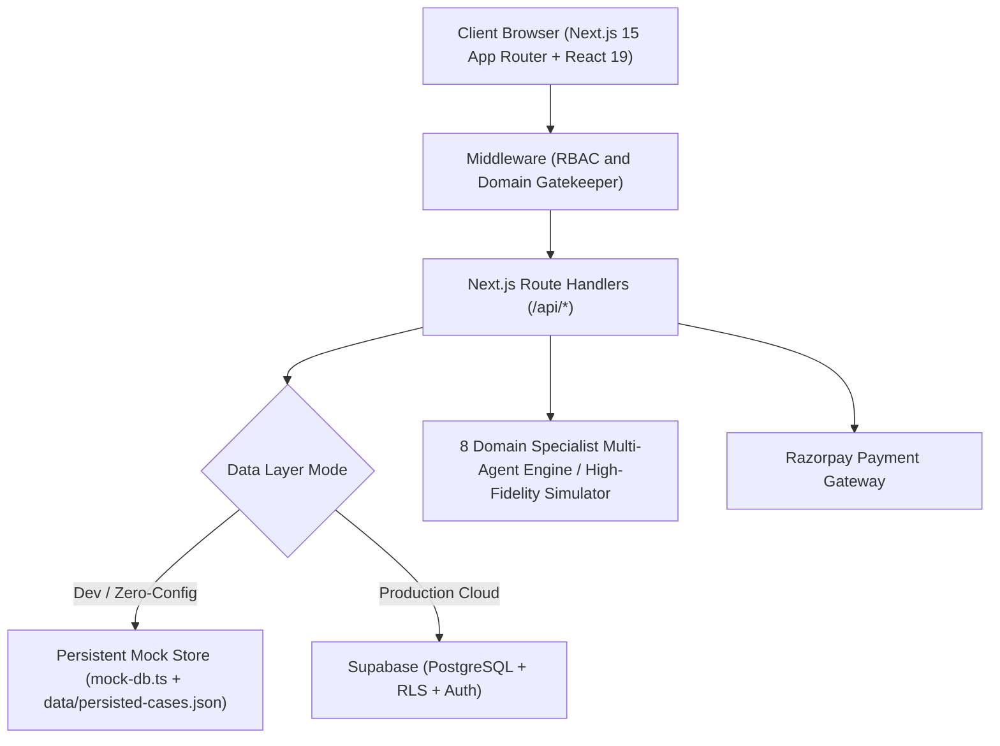

# 🏛️ SBS CaseLab — Multi-Agent AI Case Study & Curriculum Simulation Platform

[](https://nextjs.org/)
[](https://react.dev/)
[](https://www.typescriptlang.org/)
[](https://tailwindcss.com/)
[](https://supabase.com/)
[]()
[]()
[]()

> **Institutional Academic Platform for Shanti Business School (SBS)**  
> An enterprise-grade academic platform powered by an **8 Domain Specialist Multi-Agent AI System** for Harvard/Ivey-standard business case synthesis, peer-reviewed curriculum publishing, Socratic live classroom simulations, two-tier AI evaluation, and NAAC/NBA accreditation analytics.

---

## 📑 Table of Contents

1. [Platform Overview](#-platform-overview)
2. [8 Domain Specialist Multi-Agent Architecture](#-8-domain-specialist-multi-agent-architecture)
3. [Institutional Case Benchmark & Shakti Engineering Gold Standard](#-institutional-case-benchmark--shakti-engineering-gold-standard)
4. [Role-Based Dual Perspectives (Faculty vs Student)](#-role-based-dual-perspectives-faculty-vs-student)
5. [Visual Walkthrough](#-visual-walkthrough)
6. [Key Modules & Capabilities](#-key-modules--capabilities)
7. [Brand & Design System](#-brand--design-system)
8. [Architecture & Tech Stack](#-architecture--tech-stack)
9. [Quick Start & Setup](#-quick-start--setup)
10. [Environment Variables Reference](#-environment-variables-reference)
11. [Built-In Test Personas & Role Switcher](#-built-in-test-personas--role-switcher)
12. [Directory Structure](#-directory-structure)
13. [Database Schema & Migrations](#-database-schema--migrations)
14. [API Endpoints Reference](#-api-endpoints-reference)
15. [Available NPM Scripts](#-available-npm-scripts)
16. [Governance, Academic Integrity & DPDP Compliance](#-governance-academic-integrity--dpdp-compliance)
17. [Troubleshooting & FAQs](#-troubleshooting--faqs)
18. [Institutional Attribution](#-institutional-attribution)

---

## 🌟 Platform Overview

**SBS CaseLab** modernizes business school pedagogy by transforming static textbook case studies into dynamic, interactive, and accredited learning experiences. Specifically built for **Shanti Business School (SBS)**, the platform bridges classroom discussion with real-world industry dilemmas.

- 🏛️ **For Deans & Administrators**: Institutional oversight, review & approve curriculum cases, monitor token usage quotas, manage user access, export OBE curriculum attainment data, and enforce DPDP Act 2023 regulatory privacy rights.
- 👨‍🏫 **For Faculty**: Generate comprehensive 5-page case studies with realistic financial exhibits, teaching notes, and board plans in seconds using specialized domain agents; submit cases to the review queue; track student mastery; and map rubrics to NAAC/NBA program outcomes.
- 🎓 **For Students**: Solve interactive real-world dilemmas, receive instant AI rubric grading, and build a verified analytical portfolio.

---

## 🤖 8 Domain Specialist Multi-Agent Architecture

SBS CaseLab is powered by **8 Autonomous Domain Specialist Agents**, each calibrated with specialized academic frameworks, audited metrics, and pedagogical inquiry models:

| Agent Name | Academic Domain | Core Focus & Specialization | Key Analytical Frameworks |
| :--- | :--- | :--- | :--- |
| **Finance Specialist Agent** | Corporate Finance & Treasury | Capital budgeting, WACC, leverage, valuation models & loan covenants | DuPont ROE, WACC & CAPM, DCF, Debt Covenant Sensitivity |
| **Marketing Specialist Agent** | Marketing & Brand Strategy | Customer acquisition, brand equity, channel conflict & CAC/LTV | STP Model, 4Ps Marketing Mix, Keller's Brand Equity, Dual-SKU |
| **HR Specialist Agent** | Human Resources & Org Behavior | Talent retention, total rewards, appraisal friction & culture | BARS, Herzberg Motivation-Hygiene, McGregor Theory X/Y |
| **IT & Systems Specialist Agent** | Information Technology | Cloud architecture, legacy migration, cybersecurity & digital ROI | Enterprise Architecture, TOGAF, Multi-Cloud TCO, Zero Trust |
| **Supply Chain Specialist Agent** | Logistics & Supply Chain | Bullwhip effect, multi-echelon inventory, supplier risk & lead times | SCOR Model, Safety Stock & EOQ, ABC-XYZ, Vendor Scorecards |
| **Corporate Strategy Specialist Agent** | Strategy, M&A & Governance | Competitive positioning, inorganic growth, diversification & moats | Porter's Five Forces, VRIO Framework, Ansoff Matrix, Synergy |
| **Business Analytics Specialist Agent** | Data Science & Analytics | Predictive models, data drift, feature importance & MLOps | CRISP-DM, Precision/Recall Trade-offs, A/B Testing, Feature Drift |
| **Operations Management Agent** | Operations & Manufacturing | Bottleneck analysis, throughput, Lean manufacturing & Six Sigma | Theory of Constraints, OEE Decomposition, SMED, DMAIC |

---

## 🏆 Institutional Case Benchmark & Shakti Engineering Gold Standard

All generated cases and model answers conform strictly to the **Shanti Business School Gold Standard** (digitized from the landmark *"Financing Growth at Shakti Engineering Ltd."* benchmark):

1. **Enterprise Narrative & Indian Setting**: Detailed multi-section case narrative set in authentic Indian industrial hubs (Pune, Sanand, Ahmedabad, Bengaluru), featuring named protagonists and audited operational dilemmas.
2. **Consolidated Quantitative Exhibits (Exhibit 1)**: Audited multi-period balance sheet figures, transaction metrics, and financial line items in Indian Rupees (₹ Lakh / ₹ Crore).
3. **High-Order Examination Questions (Bloom's Taxonomy)**: Exactly two examination questions (20 marks each) utilizing explicit action verbs:
   - **Q1 (Analysis & Comparison)**: Diagnoses root causes and requires a structured comparison across at least 4 operational dimensions.
   - **Q2 (Evaluation & Justification)**: Evaluates managerial alternatives with itemized pros, cons, explicit limitations, and overall strategic verdicts.
4. **Institutional Model Answer Architecture**:
   - **Introduction**: Contextual framing and strategic dilemma diagnosis.
   - **Structured Comparison Table**: Basis of Comparison, Option A, and Option B across 6 operational dimensions.
   - **Itemized Decision Evaluation**: Itemized evaluation points, explicit **Limitation**, and bold **✔ Overall Verdict**.
   - **Strategic Synthesis & Conclusion**: Defensible executive recommendation aligning liquidity preservation with long-term enterprise growth.

---

## 👥 Role-Based Dual Perspectives (Faculty vs Student)

The platform provides strictly isolated, synchronized perspectives based on the active institutional role:

- 🎓 **Faculty View (`Faculty View • Model Answers Included`)**:
  - **Classroom Session Flow**: Displays the dedicated gold-key card under each phase with complete quantitative solutions, debt covenant recalculations, and consensus keys.
  - **Discussion Questions**: Displays the `Faculty Discussion Guidance & Model Answer Key` with explicit pedagogical coaching tips.
  - **Case Pack Answers Tab**: Fully unlocks complete, 5-part institutional model answer keys.
  - **Cohort Submissions & Rubrics**: Unlocks grading workflows, AI criterion evaluations, and accredited score publication.
- 👤 **Student View (`Student Practice View • Classroom Flow`)**:
  - **Clean Problem Presentation**: Shows only the case narrative, exhibits, discussion questions, and classroom timing/activity descriptions. Model solutions remain strictly confidential.
  - **Write Your Analysis Composer**: Real-time drafting workspace with live word count and 30-second autosave.
  - **Perspective Switcher**: Faculty and administrators can toggle between Faculty and Student views on the fly to inspect the exact student presentation.

---

## 📸 Visual Walkthrough

| Admin Governance & Quotas | Faculty AI Studio & Management |
| :---: | :---: |
|  |  |

| Student Case Solver & Portfolio | 1-Click Persona Switcher |
| :---: | :---: |
|  |  |

| Case Library & Search | Generate Case & Financial Exhibits |
| :---: | :---: |
|  |  |

---

## 🚀 Key Modules & Capabilities

### 1. ✍️ Generative Multi-Agent Case Studio (`/create`, `/faculty/curate`)
- **Multimodal Context Ingestion**: Upload syllabi, company annual reports, or industry whitepapers (`.pdf`, `.docx`, `.txt`) parsed via `pdf-parse` and `mammoth`.
- **Three Case Architectures**:
  - *Comprehensive 5-Page Case*: Executive narrative, dilemmas, multi-period financial tables, and strategic alternatives.
  - *FlashCase (Micro-Dilemma)*: Fast-paced 1-page situational puzzle for cold-call warmups.
  - *Real Signals*: Converts breaking industry news into immediate classroom case dilemmas.
- **English-Only Curriculum Standard**: Synthesizes authentic, rigorous business cases in clear, professional English with deep Indian enterprise context (INR Lakh / Crore figures, authentic Indian regulatory bodies such as RBI and SEBI, and regional industrial hubs).
- **Streaming & High-Fidelity Simulation Fallback**: Real-time server-sent streaming, with an intelligent built-in high-fidelity domain simulation mode for local development without external API keys.

### 2. 📊 Interactive Financial Exhibits (`InteractiveFinancialExhibit.tsx`)
- Dynamic, interactive financial models embedded into case studies.
- Supports editable revenue growth rates, COGS sensitivity sliders, and automated recalculation of Gross Profit, Operating Margin, and EBITDA.
- Switch between tabular views and dynamic visual chart projections.

### 3. ⚖️ Peer-Review & Version Control Workflow (`/review-queue`)
- **Review Pipeline**: Multi-stage approval lifecycle (`Draft` ➔ `In Review` ➔ `Changes Requested` ➔ `Approved` ➔ `Published`).
- **Immutable Version Snapshots**: Complete version history capturing timestamped revisions, diffs, and reviewer commentary.
- **Departmental Isolation**: Fine-grained access control ensuring students only access approved cases within their enrolled academic disciplines.

### 4. 🏛️ Live Socratic Classroom & Media (`/cases/[id]/live`)
- **Digital 3-Board Layout**: Synchronized facilitator dashboard for tracking Protagonists & Dilemmas, Strategic Options, and Final Action Plans.
- **Interactive Cold Calling**: Random or strategic student selection with instant rubric scoring during live sessions.
- **Real-Time Polls**: Engage student cohorts in live strategic voting scenarios with instant percentage breakdown.
- **Executive Audio Briefs ("CasePods")**: Audio summaries synthesized with multi-speaker dialogues for auditory learning and executive review.
- **Alumni Practitioner Reflections**: Real-world practitioner insights from industry alumni with community upvoting.

### 5. 🎓 Student Experience & Two-Tier AI Grading (`/student`, `/portfolio`)
- **Strategic Case Solver**: Timed submission workspace with integrated exhibit references and guided rubric criteria.
- **Speech-to-Text Voice Dictation**: Integrated voice dictation button allowing students to articulate complex qualitative arguments verbally.
- **Two-Tier Evaluation Engine**:
  - **Tier 1 (Instant AI Evaluation)**: Detailed criterion-level scoring, feedback, and improvement suggestions generated automatically.
  - **Tier 2 (Faculty Moderation & Release)**: Faculty can override, annotate, and finalize grades before publishing to students.
- **Submission Integrity Tracking**: Analyzes drafting duration, paste frequency, and editing patterns for academic integrity audits.
- **Analytical Portfolio**: Public or private portfolio showcase featuring earned credentials and verified case evaluations.

### 6. 📊 NAAC / NBA Curriculum Accreditation (`/analytics`)
- **Outcome-Based Education (OBE)**: Maps case evaluation rubrics to Course Outcomes (`CO1`–`CO5`) and Program Outcomes (`PO1`–`PO5`).
- **Real-Time Attainment Matrix**: Calculates aggregate institutional attainment scores against target thresholds.
- **One-Click CSV Export**: Pre-formatted data export with UTF-8 BOM ready for direct submission to NAAC / NBA accreditation committees.

### 7. ⌨️ Global Command Palette (`Ctrl+K` / `Cmd+K`)
- Omnipresent quick navigation and universal search.
- Search across case studies, courses, departments, and execute administrative actions instantly.

### 8. 💳 Alumni Continuing Education & DPDP Compliance (`/pricing`, `/admin`)
- **Alumni Subscription Engine**: Tiered alumni access powered by Razorpay test payment integration.
- **DPDP Act 2023 Compliance**:
  - User Data Portability (one-click JSON data export).
  - Right to be Forgotten (complete user account and activity anonymization/erasure).
  - Transparent consent logging and immutable system audit trails.
- **Institutional Token Budget Engine**:
  - Accurate API usage tracking: counts `prompt_tokens`, `completion_tokens`, and `total_tokens` directly.
  - 500,000 monthly token limit with configurable thresholds (`WARN_AT=80`, `CRITICAL_AT=95`).
  - Warning banner with SVG progress ring, monospace telemetry, model/feature breakdown drawer, and 100% budget blocking.

---

## 🎨 Brand & Design System

The platform reflects the institutional legacy and academic prestige of **Shanti Business School (SBS)**:

| Element | Design Token | Description |
|---|---|---|
| **Primary Navy** | `#0A1128` / `#0E1A38` | Deep institutional navy for sidebars, headers, and primary accents |
| **Academic Gold** | `#C5A059` / `#D4AF37` | Academic distinction accent for badges, ratings, and highlights |
| **Canvas (Light)**| `#FBF9F5` | Warm parchment off-white for high reading comfort |
| **Canvas (Dark)** | `#0B0F17` | Deep slate canvas with persistence via `localStorage` and `class="dark"` |
| **Typography** | `Lora` / `Georgia` + `Inter` | Classical serif headings paired with clean, modern sans-serif body text |

---

## 🛠️ Architecture & Tech Stack



- **Frontend Framework**: [Next.js 15](https://nextjs.org/) (App Router, Server Actions, Server Components)
- **UI Library & Styling**: [React 19](https://react.dev/), [Tailwind CSS](https://tailwindcss.com/), [Lucide React](https://lucide.dev/)
- **Document Export**: `jspdf` (PDF case study reports), `docx` (Word case study export)
- **Document Ingestion**: `mammoth` (Word document parsing), `pdf-parse` (PDF text extraction)
- **Authentication & Database**: [Supabase](https://supabase.com/) (SSR Auth, PostgreSQL with Row-Level Security)
- **AI Synthesis**: Institutional Multi-Agent Reasoning Engine & Dynamic Domain Calibration
- **Testing & Tooling**: TypeScript 5.8, ESLint 9, `tsx`, Puppeteer

---

## ⚡ Quick Start & Setup

### 1. Prerequisites
- **Node.js**: v18.17+ or v20+ (tested on Node v20 & v22)
- **npm**: v9+ (packaged with Node.js)

Verify your environment:
```bash
node -v
npm -v
```

---

### 2. Installation
Clone or extract the repository, then install project dependencies:
```bash
npm install
```

---

### 3. Environment Configuration
Copy `.env.example` to create your `.env.local` configuration:

**Windows (PowerShell):**
```powershell
Copy-Item .env.example .env.local
```

**macOS / Linux:**
```bash
cp .env.example .env.local
```

> [!NOTE]
> **Zero External Setup Required**: The application includes an in-memory persistent database (`src/lib/mock-db.ts` with local disk caching) and high-fidelity offline multi-agent simulation. It runs completely out-of-the-box without requiring live external cloud credentials!

---

### 4. Run the Development Server
```bash
npm run dev
```

Open your browser and visit:  
👉 **`http://localhost:3000`**

---

## ⚙️ Environment Variables Reference

| Variable | Required | Default / Example | Purpose |
|---|:---:|---|---|
| `NEXT_PUBLIC_APP_NAME` | No | `"SBS CaseLab"` | Display name shown throughout the application |
| `NEXT_PUBLIC_COLLEGE_NAME` | No | `"Shanti Business School"` | Full institutional name |
| `NEXT_PUBLIC_COLLEGE_SHORT` | No | `"SBS"` | Short acronym for badges and compact headers |
| `NEXT_PUBLIC_COLLEGE_EMAIL_DOMAIN` | No | `"shantibschool.edu.in"` | Mandatory email domain for user registration |
| `NEXT_PUBLIC_ENABLE_DEMO_MODE` | No | `"true"` | Enables 1-click Persona Switcher in dev environments |
| `SESSION_SECRET` | Yes | `"sbs_caselab_secure_session_..."` | Key used for encrypting session cookies |
| `DEMO_USER_PASSWORD` | No | `"SBS_SecurePassword2026!"` | Default password for seeded accounts (if not set, random generated) |
| `REQUIRE_ADMIN_APPROVAL` | No | `"true"` | Enforces admin verification before accounts can author or access cases |
| `ACCESS_DURATION_MONTHS` | No | `"12"` | Grace period duration in months after batch graduation |
| `REVIEW_REMINDER_DAYS` | No | `"3"` | Days before an assigned peer review is flagged overdue |
| `WORDS_PER_PAGE` | No | `"500"` | Standard academic budgeting ratio for page calculations |
| `ENROLLMENT_REGEX` | No | `"^SBS\\/[0-9]{4}\\/[0-9]{4}$"` | Validation regex for student enrollment numbers (e.g. `SBS/2024/0001`) |
| `EMPLOYEE_ID_REGEX` | No | `"^SBS\\/FAC\\/[0-9]{3,4}$"` | Validation regex for faculty employee IDs (e.g. `SBS/FAC/101`) |
| `FEATURE_STUDENT_ANSWERS` | No | `"false"` | Flag preserving student case answering workspace |
| `FEATURE_PORTFOLIO` | No | `"false"` | Flag preserving student analytical portfolio |
| `FEATURE_OBE_ANALYTICS` | No | `"false"` | Flag preserving NAAC / NBA OBE accreditation matrix |
| `PAYMENTS_ENABLED` | No | `"false"` | Flag gating commercial alumni subscriptions and repository monetization |
| `PAID_DOWNLOADS` | No | `"false"` | Flag gating pay-per-download for alumni and external readers |
| `DEFAULT_CREATOR_SHARE_PCT` | No | `"60"` | Creator royalty share percentage for commercial case purchases |
| `ALUMNI_ANNUAL_PRICE_INR` | No | `"2999"` | Annual subscription price in INR for alumni repository access |
| `ALLOWED_EXTERNAL_COLLEGE_DOMAINS` | No | `""` | Comma-separated list of approved partner university domains |
| `NEXT_PUBLIC_SUPABASE_URL` | Prod | `"https://your-id.supabase.co"` | Supabase instance URL (optional in dev) |
| `NEXT_PUBLIC_SUPABASE_ANON_KEY` | Prod | `"eyJhbGci..."` | Supabase anonymous public key |
| `SUPABASE_SERVICE_ROLE_KEY` | Prod | `"eyJhbGci..."` | Supabase privileged service-role key |
| `TOKEN_BUDGET` | No | `500000` | Monthly institutional token allocation limit |
| `WARN_AT` | No | `80` | Warning banner percentage threshold (80-94% orange state) |
| `CRITICAL_AT` | No | `95` | Critical alert percentage threshold (95%+ red state) |
| `AI_ENGINE_API_KEY` | No | `"sk-..."` | Primary AI Engine key (simulated offline multi-agent mode used if blank) |
| `NEXT_PUBLIC_RAZORPAY_KEY_ID` | No | `"rzp_test_..."` | Razorpay key ID for alumni subscriptions |
| `RAZORPAY_KEY_SECRET` | No | `"test_secret_..."` | Razorpay secret for signature validation |
| `DEMO_PAYMENTS` | No | `"false"` | Simulate payments without contacting payment gateway |

---

## 👥 Built-In Test Personas & Role Switcher

When running locally in development mode (`NODE_ENV !== "production"` or `NEXT_PUBLIC_ENABLE_DEMO_MODE="true"`), a **Persona Switcher** is accessible directly in the top navigation profile dropdown and login page for instant authentication without password entry. If logging in via standard credentials, seed demo accounts utilize the password configured via the `DEMO_USER_PASSWORD` environment variable (or one-time generated secure credentials printed during `npm run seed`).

### Institutional Roles & Hierarchy
The platform enforces exactly three core database roles:
1. **`admin`**: System administrator and dean-level governance. Exactly one admin account exists, created solely via seed or server-side provisioning. The sign-up API strictly blocks and rejects any registration with an `admin` role.
2. **`faculty`**: Academic faculty members eligible to draft case studies, review student submissions, and participate in peer review.
3. **`student`**: Enrolled students who can author student-led cases, submit cases for faculty review, and access published cases in the institutional repository.

> **Reviewer Designation**: Reviewer is **NOT** a database role. It is a boolean administrative capability flag on faculty (`is_reviewer: true`), displayed in the interface as **"Faculty Member and Reviewer"**. Reviewers cannot be unassigned if they currently have pending assigned reviews.

| Role | Persona Name | Institutional Email | Academic Details | Key Permissions |
|---|---|---|---|---|
| **Administrator** | Dr. Neha Sharma | `admin@shantibschool.edu.in` | Dean / Institutional Governance | Case approval, user & role management, lookup lists, token budgets, DPDP compliance, audit logs |
| **Faculty Member & Reviewer** | Ms. Reena Paswan | `reena.paswan@shantibschool.edu.in` | Department: BCA/IT • Course: BCA • Full-time | Case Studio authoring, teaching notes, peer review queue (`is_reviewer=true`) |
| **Faculty Member & Reviewer** | Dr. Vikram Mehta | `vikram.mehta@shantibschool.edu.in` | Department: Finance • Course: PGDM • Full-time | Case authoring, financial exhibits, peer review queue (`is_reviewer=true`) |
| **Student** | Zala Prachi | `prachi.z24bca@shantibschool.edu.in` | BCA • Batch: 2024–27 • Roll: 01 • Enr: `SBS/2024/0001` | Case creation, submit for review, repository search, on-screen practice |

---

## 📂 Directory Structure

```text
Case_Study/
├── public/                 # Static assets, branding logos, and screenshot previews
│   ├── sbs-logo.png
│   ├── sbs-corporate-logo.png
│   └── screenshots/        # High-resolution UI captures (dark/light mode)
├── reference/              # Gold-standard reference cases and curricula
│   └── gold/
│       └── finance_approved.json # Shakti Engineering Ltd. Institutional Gold Benchmark
├── scripts/                # Database seeding & automated acceptance tests
│   ├── seed.ts             # Seeds 1 Admin, 2 Faculty, 10 Students, courses & cases
│   └── test-acceptance.ts  # End-to-end acceptance verification suite (41 test assertions)
├── src/
│   ├── app/                # Next.js 15 App Router pages & API routes
│   │   ├── (auth)/         # Login, registration, role switcher
│   │   ├── admin/          # Governance, user management, audit logs
│   │   ├── analytics/      # NAAC / NBA OBE curriculum attainment matrix
│   │   ├── api/            # Serverless route handlers (AI, auth, cases, grades)
│   │   ├── cases/          # Case viewer, live Socratic classroom, exports
│   │   ├── create/         # Generative AI Case Studio & exhibit editor
│   │   ├── dashboard/      # Role-based dashboard (Admin/Faculty/Student)
│   │   ├── library/        # Searchable repository and custom collections
│   │   ├── portfolio/      # Student analytical showcase & evaluations
│   │   ├── pricing/        # Alumni continuing education subscriptions
│   │   └── review-queue/   # Peer-review queue for curriculum approval
│   ├── components/         # Reusable UI component library & layout wrappers
│   │   ├── AppShell.tsx                    # Main navigation shell with responsive drawer
│   │   ├── CommandPalette.tsx              # Global search and keyboard shortcuts (Ctrl+K)
│   │   ├── InteractiveFinancialExhibit.tsx # Dynamic P&L / balance sheet modeling
│   │   ├── AudioBriefPlayer.tsx            # Multi-speaker executive audio summaries
│   │   └── NotificationDropdown.tsx        # Real-time alert centre
│   ├── config/             # Institutional branding constants (college.ts, theme.ts)
│   └── lib/                # Data stores, session auth, AI SDK, error tracking
│       ├── agents/
│       │   └── domain-agents.ts # 8 Domain Specialist Agents implementation
│       ├── casepack/
│       │   ├── generate.ts      # Multi-stage case and answer synthesis pipeline
│       │   └── schema.ts        # Zod validation schemas
│       ├── mock-db.ts      # Persistent local cache & in-memory data store
│       └── session.ts      # Cookie session encryption & verification
└── supabase/
    └── migrations/         # Production-ready PostgreSQL DDL & RLS policies
```

---

## 🗄️ Database Schema & Migrations

For production deployment with a live Supabase PostgreSQL database, the repository includes 16 sequential migrations in `supabase/migrations/`:

| # | Migration File | Scope & Capabilities Added |
|---|---|---|
| 1 | `00001_initial_schema.sql` | Base `profiles`, `departments`, `courses`, `cases`, `usage_log`, and initial RLS policies. |
| 2 | `00002_library_approval_versions.sql` | `case_versions`, `collections`, `collection_cases`, and reviewer capability flags. |
| 3 | `00003_student_experience_rubrics_grades.sql` | `rubrics`, `rubric_criteria`, `student_answers`, `grades`, and student portfolios. |
| 4 | `00004_outcomes_signals_analytics.sql` | `outcomes` (CO/PO), `case_outcomes`, `signals` radar, and faculty watchlists. |
| 5 | `00005_live_classroom_integrity_reflections.sql` | `classroom_sessions`, `audio_briefs`, `integrity_reports`, and practitioner notes. |
| 6 | `00006_subscriptions_audit_dpdp.sql` | `subscriptions`, `audit_logs`, and DPDP Act 2023 compliance handlers. |
| 7 | `00007_update_college_domain_and_name.sql` | Institutional branding and `@shantibschool.edu.in` identity migration. |
| 8 | `00008_update_email_domain_to_edu_in.sql` | Domain constraints and email normalization rules. |
| 9 | `00009_free_usage_and_external_users.sql` | External user tiering, guest exploration quotas, and rate limiting. |
| 10 | `00010_database_upgrade.sql` | Comprehensive column migrations, foreign keys, and RLS policy consolidation. |
| 11 | `00011_rls_security_tests.sql` | Automated pgTAP / SQL validation tests for RLS policy boundaries. |
| 12 | `00012_ce_casepack.sql` | Continuing Education (CE) CasePack metadata, syllabus ingest, and feedback tables. |
| 13 | `00013_token_usage.sql` | Granular per-request token usage tracking, prompts, and audit records. |
| 14 | `00014_dpdp_consent_versioning.sql` | DPDP statutory consent version tracking (`consent_version`, `consent_at`). |
| 15 | `00015_case_repository_schema.sql` | Lookup tables, institutional profiles, and review round workflows. |
| 16 | `00016_case_repository_rls_functions.sql` | Atomic reviewer rotation, immutable audit triggers, and database-level student answer key scrubbing. |

---

## 🔌 API Endpoints Reference

| Endpoint | Method | Description |
|---|:---:|---|
| `/api/auth` | `POST` | Authenticate (dual-login with SBS or personal email), sign up, OTP requests, or switch personas |
| `/api/lookup` | `GET` | Retrieve active academic lookup options (departments, courses, batches, faculty types, categories) |
| `/api/cases` | `GET`, `POST` | Fetch case library or draft new case studies with lookup attributes and page targets |
| `/api/cases/[id]/review-comments` | `GET`, `POST` | Fetch or record granular section-level review feedback in the Review Drawer |
| `/api/cases/[id]/upload` | `POST` | Institutional Upload Gate (strictly gates approved cases, checks author consent, publishes to repository) |
| `/api/repository` | `GET` | Faceted search across published repository items (department, course, category, query) |
| `/api/repository/download` | `GET` | Permissioned case downloads (students receive scrubbed clean copy; faculty receive teaching notes) |
| `/api/review-queue` | `GET`, `POST` | Peer-review queue for assigned faculty reviewers |
| `/api/admin` | `GET`, `POST` | Dean/Admin telemetry dashboard, reviewer toggling, reviewer reassignment, access renewal |
| `/api/admin/academic-lists` | `GET`, `POST` | Academic list CRUD (departments, courses, batches, faculty types, categories) with audit logging |
| `/api/admin/pending-registrations` | `GET`, `POST` | Single and bulk approval/rejection of pending student and faculty registrations |
| `/api/cron/access-expiration` | `GET`, `POST` | Daily scheduled cron to mark expired accounts, compute alumni transitions, and issue reminders |
| `/api/user/data-export` | `GET` | Export personal user data in JSON format (DPDP Act 2023) |
| `/api/user/data-delete` | `POST` | Exercise Right to Erasure / account anonymization (DPDP Act 2023) |
| `/api/user/consent-withdraw` | `POST` | Revoke DPDP statutory consent |
| `/api/payments/razorpay/order` | `POST` | Create order for alumni subscription |
| `/api/payments/razorpay/verify` | `POST` | Verify cryptographic signature and activate subscription |

---

## 📜 Available NPM Scripts

| Command | Description |
|---|---|
| `npm run dev` | Starts the Next.js development server at `http://localhost:3000` |
| `npm run build` | Compiles and validates the production build (TypeScript + linting, all 53 routes) |
| `npm run start` | Boots the compiled production server |
| `npm run lint` | Runs Next.js ESLint verification |
| `npm run seed` | Executes `scripts/seed.ts` to reset & seed initial database records |
| `npm test` | Runs comprehensive acceptance verification suite (41/41 verified assertions passed) |

---

## 🛡️ Governance, Academic Integrity & DPDP Compliance

SBS CaseLab adheres to strict academic integrity standards and Indian data privacy regulations:

- **Institutional Domain Gatekeeping**: Email addresses are validated against `@shantibschool.edu.in` to prevent unauthorized external access.
- **Role-Based Access Control (RBAC)**: Enforced via `src/middleware.ts` to guard administrative, faculty, reviewer, and student routes.
- **Academic Integrity Engine**: Captures writing duration, paste bursts, and AI probability to ensure ethical student analysis.
- **DPDP Act 2023 Compliance**:
  - **Data Export (`/api/user/data-export`)**: Users can download a machine-readable JSON copy of all personal submissions, grades, and profile metadata.
  - **Right to Erasure (`/api/user/data-delete`)**: Immediate anonymization and purging of identifiable user records upon verified request.
  - **Right to Withdraw Consent (`/api/user/consent-withdraw`)**: Users can withdraw statutory consent anytime via `/privacy`.
  - **Comprehensive Audit Trails**: Timestamped tracking of all administrative role adjustments, quota modifications, and case status changes.

---

## ❓ Troubleshooting & FAQs

<details>
<summary><b>1. Port 3000 is already in use</b></summary>

You can specify an alternate port when running the dev server:
```bash
npm run dev -- -p 3001
```
Or terminate the process occupying port 3000:
- **Windows**: `Stop-Process -Id (Get-NetTCPConnection -LocalPort 3000).OwningProcess -Force`
- **macOS/Linux**: `lsof -ti:3000 | xargs kill -9`
</details>

<details>
<summary><b>2. How to test real AI generation with live API keys?</b></summary>

Provide a valid AI Engine API key in `.env.local`:
```env
AI_ENGINE_API_KEY="sk-..."
```
If this variable is blank or omitted, the application seamlessly uses the built-in high-fidelity domain specialist simulation mode, allowing full feature evaluation without incurring external API costs.
</details>

<details>
<summary><b>3. Why did changes reset after restarting the server?</b></summary>

The default local development configuration uses the persistent mock database store (`src/lib/mock-db.ts` with disk caching in `data/persisted-cases.json`). To connect a Supabase cloud database, configure `NEXT_PUBLIC_SUPABASE_URL` and `SUPABASE_SERVICE_ROLE_KEY` in `.env.local` and execute `npx supabase db push`.
</details>

<details>
<summary><b>4. How to switch roles during testing?</b></summary>

Simply use the **Persona Switcher** pinned to the lower portion of the sidebar or the login page. In demo mode (`NEXT_PUBLIC_ENABLE_DEMO_MODE="true"`), you can switch between Admin, Faculty, Reviewer, and Student with one click.
</details>

---

## 🚀 Deployment Guide: Vercel + Supabase

### Step 1: Supabase Database Setup
1. Create a new project in the [Supabase Dashboard](https://supabase.com/dashboard).
2. Retrieve your **Project URL**, **Anon Public Key**, and **Service Role Key** under **Project Settings $\rightarrow$ API**.
3. Push all migration files sequentially using Supabase CLI or SQL Editor:
   ```bash
   supabase link --project-ref your-project-id
   supabase db push
   ```

### Step 2: Vercel Project Deployment
1. Import your GitHub repository to [Vercel](https://vercel.com).
2. Framework Preset: **Next.js**
3. Root Directory: `./`
4. Build Command: `npm run build`
5. Output Directory: `.next`

### Step 3: Configure Environment Variables in Vercel
Add the following production environment variables under **Project Settings $\rightarrow$ Environment Variables**:
- `NEXT_PUBLIC_APP_NAME`: `SBS CaseLab`
- `NEXT_PUBLIC_COLLEGE_NAME`: `Shanti Business School`
- `NEXT_PUBLIC_COLLEGE_SHORT`: `SBS`
- `NEXT_PUBLIC_COLLEGE_EMAIL_DOMAIN`: `shantibschool.edu.in`
- `NEXT_PUBLIC_SUPABASE_URL`: `https://<your-project>.supabase.co`
- `NEXT_PUBLIC_SUPABASE_ANON_KEY`: Supabase Public Anonymous API Key
- `SUPABASE_SERVICE_ROLE_KEY`: Supabase Service Role Secret Key

### Step 4: Configure Razorpay Webhooks
1. Open the [Razorpay Dashboard](https://dashboard.razorpay.com/) $\rightarrow$ **Settings $\rightarrow$ Webhooks**.
2. Add Webhook URL: `https://your-domain.vercel.app/api/webhooks/razorpay`.
3. Secret: Enter the same secret configured in `RAZORPAY_WEBHOOK_SECRET`.
4. Active Events: Select `payment.captured`, `order.paid`, `subscription.charged`.

### Step 5: Execute Initial Production Seed
Populate the production database with accredited departments, courses, and administrator accounts:
```bash
npm run seed
```

---

## 📋 Production Readiness Checklist

- [x] **8 Domain Specialist Multi-Agent System**: Verified active across Finance, Marketing, HR, IT, Supply Chain, Strategy, Analytics, and Operations.
- [x] **Security & Domain Isolation**: Only verified institutional emails ending with `@shantibschool.edu.in` are allowed registration.
- [x] **Zero API Key Exposure**: AI Engine and Supabase Service Role keys are strictly kept server-side in `.env.local` / Vercel Environment Variables.
- [x] **HTTP Hardening**: Mandatory security headers (`X-Frame-Options: DENY`, `X-Content-Type-Options: nosniff`, `Referrer-Policy`, CSP) enforced on all routes.
- [x] **Rate Limiting**: Per-user sliding hourly rate limit (10 generations/hr) protects API keys from exhaustion.
- [x] **PostgreSQL Row Level Security (RLS)**: Cryptographically prevents cross-student answer reading and restricts unapproved cases.
- [x] **Audit Logging Ledger**: Immutable audit entries logged for role modifications, approvals, grade overrides, and data subject actions.
- [x] **Cryptographic Payment Verification**: HMAC-SHA256 signature verification active on order completion and webhook endpoints; invalid signatures rejected with HTTP 400.
- [x] **Alumni Perpetual Work Access**: Graduated students permanently keep free download access to their portfolio and answers regardless of subscription status.
- [x] **DPDP Act 2023 Compliance**: Mandatory registration consent checkbox, machine-readable JSON data export (`/api/user/data-export`), and permanent account erasure (`/api/user/data-delete`).
- [x] **Institutional Token Budget Alerts**: Real-time quota calculation with automatic 80% warning banner across faculty workspaces.
- [x] **Document Extraction & Audio Synthesizer**: Native server-side parsing for PDF/DOCX and client-side speech synthesis audio briefing ("CasePod").
- [x] **English-Only Curriculum Standard**: Verified strict English generation with authentic Indian business context (INR figures, statutory compliance, and domestic industrial hubs).

---

## 🏛️ Institutional Attribution

Developed for **Shanti Business School (SBS)**  
*Nurturing Business Leaders Through Applied Academic Innovation*  
Ahmedabad, Gujarat, India • [shantibschool.edu.in](https://shantibschool.edu.in)
