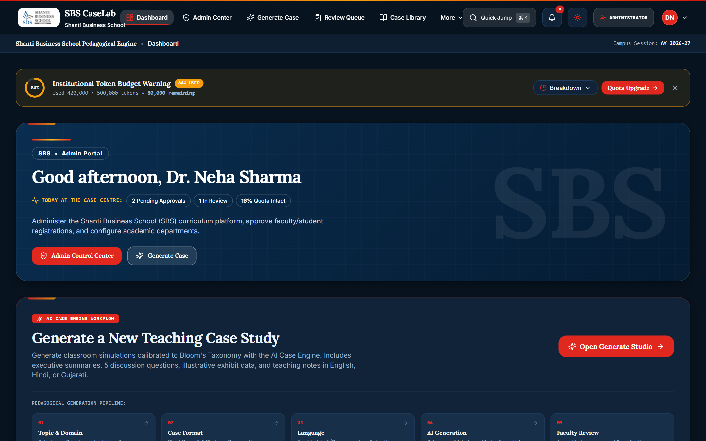
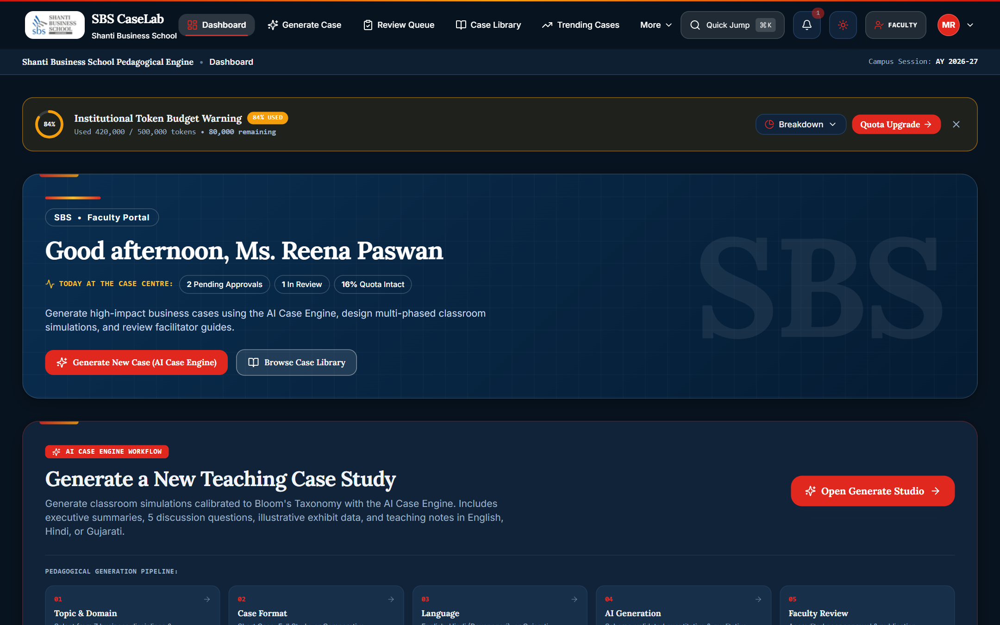
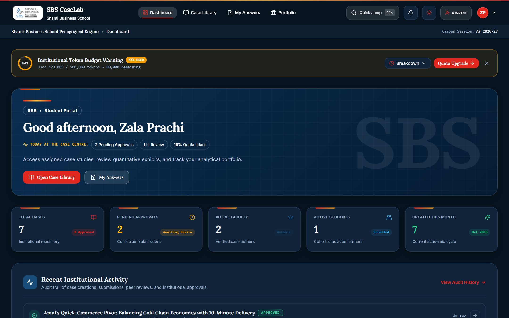
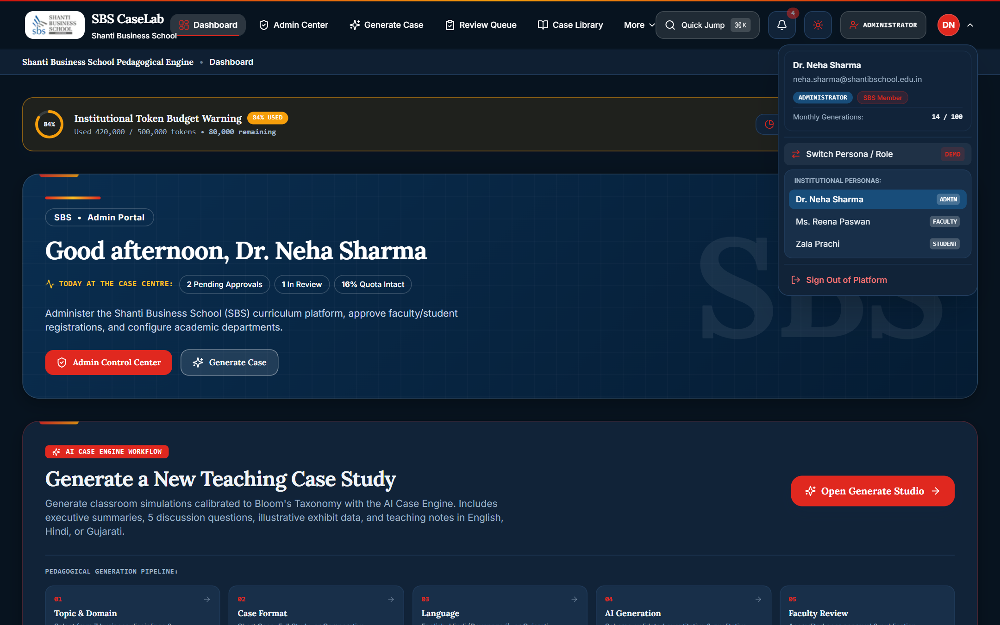
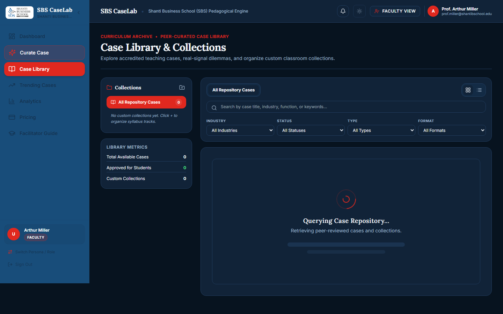
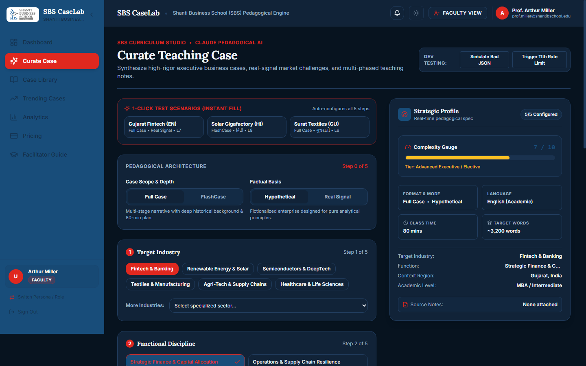

# 🏛️ SBS CaseLab — AI Case Study & Curriculum Simulation Platform

[](https://nextjs.org/)
[](https://react.dev/)
[](https://www.typescriptlang.org/)
[](https://tailwindcss.com/)
[](https://supabase.com/)
[](https://www.anthropic.com/)
[]()
[]()

> **Institutional Academic Platform for Shanti Business School (SBS)**  
> An enterprise-grade academic platform for generative AI business case synthesis, peer-reviewed curriculum publishing, Socratic live classroom simulations, two-tier AI evaluation, and NAAC/NBA accreditation analytics.

---

## 📑 Table of Contents

1. [Platform Overview](#-platform-overview)
2. [Visual Walkthrough](#-visual-walkthrough)
3. [Key Modules & Capabilities](#-key-modules--capabilities)
4. [Brand & Design System](#-brand--design-system)
5. [Architecture & Tech Stack](#-architecture--tech-stack)
6. [Quick Start & Setup](#-quick-start--setup)
7. [Environment Variables Reference](#-environment-variables-reference)
8. [Built-In Test Personas & Role Switcher](#-built-in-test-personas--role-switcher)
9. [Directory Structure](#-directory-structure)
10. [Database Schema & Migrations](#-database-schema--migrations)
11. [API Endpoints Reference](#-api-endpoints-reference)
12. [Available NPM Scripts](#-available-npm-scripts)
13. [Governance, Academic Integrity & DPDP Compliance](#-governance-academic-integrity--dpdp-compliance)
14. [Troubleshooting & FAQs](#-troubleshooting--faqs)
15. [Institutional Attribution](#-institutional-attribution)

---

## 🌟 Platform Overview

**SBS CaseLab** modernizes business school pedagogy by transforming static textbook case studies into dynamic, interactive, and accredited learning experiences. Specifically built for **Shanti Business School (SBS)**, the platform bridges classroom discussion with real-world industry dilemmas.

- 🏛️ **For Deans & Administrators**: Institutional oversight, review & approve curriculum cases, monitor token usage quotas, manage user access, export OBE curriculum attainment data, and enforce DPDP Act 2023 regulatory privacy rights.
- 👨‍🏫 **For Faculty**: Generate comprehensive 5-page case studies with realistic financial exhibits, teaching notes, and board plans in seconds using generative AI; submit cases to the review queue; track student mastery; and map rubrics to NAAC/NBA program outcomes.
- 🎓 **For Students**: Solve interactive real-world dilemmas, receive instant AI rubric grading, build a verified analytical portfolio, and earn downloadable certificates.

---

## 📸 Visual Walkthrough

| Admin Governance & Quotas | Faculty AI Studio & Management |
| :---: | :---: |
|  |  |

| Student Case Solver & Portfolio | 1-Click Persona Switcher |
| :---: | :---: |
|  |  |

| Case Library & Search | Generate Case & Financial Exhibits |
| :---: | :---: |
|  |  |

---

## 🚀 Key Modules & Capabilities

### 1. ✍️ Generative AI Case Studio (`/create`, `/faculty/curate`)
- **Multimodal Context Ingestion**: Upload syllabi, company annual reports, or industry whitepapers (`.pdf`, `.docx`, `.txt`) parsed via `pdf-parse` and `mammoth`.
- **Three Case Architectures**:
  - *Comprehensive 5-Page Case*: Executive narrative, dilemmas, multi-period financial tables, and strategic alternatives.
  - *FlashCase (Micro-Dilemma)*: Fast-paced 1-page situational puzzle for cold-call warmups.
  - *Real Signals*: Converts breaking industry news into immediate classroom case dilemmas.
- **Multilingual Support**: Synthesizes authentic Indian business cases in **English**, **Hindi (हिंदी)**, and **Gujarati (ગુજરાતી)** with full Unicode rendering.
- **Streaming & Offline Fallback**: Real-time server-sent streaming using Anthropic Claude 3.5 Sonnet, with an intelligent built-in offline simulation mode for local development without API keys.

### 2. 📊 Interactive Financial Exhibits (`InteractiveFinancialExhibit.tsx`)
- Dynamic, interactive financial models embedded into case studies.
- Supports editable revenue growth rates, COGS sensitivity sliders, and automated recalculation of Gross Profit, Operating Margin, and EBITDA.
- Switch between tabular views and dynamic visual chart projections.

### 3. ⚖️ Peer-Review & Version Control Workflow (`/review-queue`)
- **Review Pipeline**: Multi-stage approval lifecycle (`Draft` ➔ `In Review` ➔ `Changes Requested` ➔ `Approved` ➔ `Published`).
- **Immutable Version Snapshots**: Complete version history capturing timestamped revisions, diffs, and reviewer commentary.
- **Departmental Isolation**: Fine-grained access control ensuring students only access approved cases within their enrolled academic disciplines.

### 4. 🏛️ Live Socratic Classroom & Media (`/cases/[id]/live`)
- **Digital 3-Board Layout**: Synchronized facilitator dashboard for tracking Protagonists & Dilemmas, Strategic Options, and Final Action Plans.
- **Interactive Cold Calling**: Random or strategic student selection with instant rubric scoring during live sessions.
- **Real-Time Polls**: Engage student cohorts in live strategic voting scenarios with instant percentage breakdown.
- **Executive Audio Briefs ("CasePods")**: Audio summaries synthesized with multi-speaker dialogues for auditory learning and executive review.
- **Alumni Practitioner Reflections**: Real-world practitioner insights from industry alumni with community upvoting.

### 5. 🎓 Student Experience & Two-Tier AI Grading (`/student`, `/portfolio`)
- **Strategic Case Solver**: Timed submission workspace with integrated exhibit references and guided rubric criteria.
- **Speech-to-Text Voice Dictation**: Integrated voice dictation button allowing students to articulate complex qualitative arguments verbally.
- **Two-Tier Evaluation Engine**:
  - **Tier 1 (Instant AI Evaluation)**: Detailed criterion-level scoring, feedback, and improvement suggestions generated automatically.
  - **Tier 2 (Faculty Moderation & Release)**: Faculty can override, annotate, and finalize grades before publishing to students.
- **Submission Integrity Tracking**: Analyzes drafting duration, paste frequency, and editing patterns for academic integrity audits.
- **Analytical Portfolio & Certificates**: Public or private portfolio showcase featuring earned credentials and printable PDF Certificates of Mastery.

### 6. 📊 NAAC / NBA Curriculum Accreditation (`/analytics`)
- **Outcome-Based Education (OBE)**: Maps case evaluation rubrics to Course Outcomes (`CO1`–`CO5`) and Program Outcomes (`PO1`–`PO5`).
- **Real-Time Attainment Matrix**: Calculates aggregate institutional attainment scores against target thresholds.
- **One-Click CSV Export**: Pre-formatted data export with UTF-8 BOM ready for direct submission to NAAC / NBA accreditation committees.

### 7. ⌨️ Global Command Palette (`Ctrl+K` / `Cmd+K`)
- Omnipresent quick navigation and universal search.
- Search across case studies, courses, departments, and execute administrative actions instantly.

### 8. 💳 Alumni Continuing Education & DPDP Compliance (`/pricing`, `/admin`)
- **Alumni Subscription Engine**: Tiered alumni access powered by Razorpay test payment integration.
- **DPDP Act 2023 Compliance**:
  - User Data Portability (one-click JSON data export).
  - Right to be Forgotten (complete user account and activity anonymization/erasure).
  - Transparent consent logging and immutable system audit trails.

---

## 🎨 Brand & Design System

The platform reflects the institutional legacy and academic prestige of **Shanti Business School (SBS)**:

| Element | Design Token | Description |
|---|---|---|
| **Primary Navy** | `#0A1128` / `#0E1A38` | Deep institutional navy for sidebars, headers, and primary accents |
| **Academic Gold** | `#C5A059` / `#D4AF37` | Academic distinction accent for badges, ratings, and highlights |
| **Canvas (Light)**| `#FBF9F5` | Warm parchment off-white for high reading comfort |
| **Canvas (Dark)** | `#0B0F17` | Deep slate canvas with persistence via `localStorage` and `class="dark"` |
| **Typography** | `Lora` / `Georgia` + `Inter` | Classical serif headings paired with clean, modern sans-serif body text |

---

## 🛠️ Architecture & Tech Stack

```mermaid
graph TD
    Client["Client Browser (Next.js 15 App Router + React 19)"]
    MW["Middleware (RBAC & Domain Gatekeeper)"]
    API["Next.js Route Handlers (/api/*)"]
    Store{"Data Layer Mode"}
    Mock["In-Memory Mock Store (mock-db.ts)"]
    Supa["Supabase (PostgreSQL + RLS + Auth)"]
    AI["Anthropic Claude 3.5 Sonnet / Offline Fallback"]
    Pay["Razorpay Payment Gateway"]

    Client --> MW
    MW --> API
    API --> Store
    Store -- Dev / Zero-Config -- --> Mock
    Store -- Production Cloud -- --> Supa
    API --> AI
    API --> Pay
```

- **Frontend Framework**: [Next.js 15](https://nextjs.org/) (App Router, Server Actions, Server Components)
- **UI Library & Styling**: [React 19](https://react.dev/), [Tailwind CSS](https://tailwindcss.com/), [Lucide React](https://lucide.dev/)
- **Document Export**: `jspdf` (PDF reports & certificates), `docx` (Word case study export)
- **Document Ingestion**: `mammoth` (Word document parsing), `pdf-parse` (PDF text extraction)
- **Authentication & Database**: [Supabase](https://supabase.com/) (SSR Auth, PostgreSQL with Row-Level Security)
- **AI Synthesis**: [Anthropic Claude SDK](https://www.anthropic.com/) (`@anthropic-ai/sdk`)
- **Testing & Tooling**: TypeScript 5.8, ESLint 9, `tsx`, Puppeteer

---

## ⚡ Quick Start & Setup

### 1. Prerequisites
- **Node.js**: v18.17+ or v20+ (tested on Node v20 & v22)
- **npm**: v9+ (packaged with Node.js)

Verify your environment:
```bash
node -v
npm -v
```

---

### 2. Installation
Clone or extract the repository, then install project dependencies:
```bash
npm install
```

---

### 3. Environment Configuration
Copy `.env.example` to create your `.env.local` configuration:

**Windows (PowerShell):**
```powershell
Copy-Item .env.example .env.local
```

**Windows (Command Prompt):**
```cmd
copy .env.example .env.local
```

**macOS / Linux:**
```bash
cp .env.example .env.local
```

> [!NOTE]
> **Zero External Setup Required**: The application includes an in-memory singleton database (`src/lib/mock-db.ts`) and offline AI fallback. It runs completely out-of-the-box without requiring live Supabase or Anthropic credentials!

---

### 4. Run the Development Server
```bash
npm run dev
```

Open your browser and visit:  
👉 **`http://localhost:3000`**

---

## ⚙️ Environment Variables Reference

| Variable | Required | Default / Example | Purpose |
|---|:---:|---|---|
| `NEXT_PUBLIC_APP_NAME` | No | `"SBS CaseLab"` | Display name shown throughout the application |
| `NEXT_PUBLIC_COLLEGE_NAME` | No | `"Shanti Business School"` | Full institutional name |
| `NEXT_PUBLIC_COLLEGE_SHORT` | No | `"SBS"` | Short acronym for badges and compact headers |
| `NEXT_PUBLIC_COLLEGE_EMAIL_DOMAIN` | No | `"shantibschool.edu.in"` | Mandatory email domain for user registration |
| `NEXT_PUBLIC_ENABLE_DEMO_MODE` | No | `"true"` | Enables 1-click Persona Switcher in dev environments |
| `SESSION_SECRET` | Yes | `"sbs_caselab_secure_session_..."` | Key used for encrypting session cookies |
| `NEXT_PUBLIC_SUPABASE_URL` | Prod | `"https://your-id.supabase.co"` | Supabase instance URL (optional in dev) |
| `NEXT_PUBLIC_SUPABASE_ANON_KEY` | Prod | `"eyJhbGci..."` | Supabase anonymous public key |
| `SUPABASE_SERVICE_ROLE_KEY` | Prod | `"eyJhbGci..."` | Supabase privileged service-role key |
| `ANTHROPIC_API_KEY` | No | `"sk-ant-..."` | Claude API key (simulated offline mode used if blank) |
| `NEXT_PUBLIC_RAZORPAY_KEY_ID` | No | `"rzp_test_..."` | Razorpay key ID for alumni subscriptions |
| `RAZORPAY_KEY_SECRET` | No | `"test_secret_..."` | Razorpay secret for signature validation |
| `DEMO_PAYMENTS` | No | `"false"` | Simulate payments without contacting payment gateway |

---

## 👥 Built-In Test Personas & Role Switcher

When running locally in development mode (`NODE_ENV !== "production"` or `NEXT_PUBLIC_ENABLE_DEMO_MODE="true"`), a **Persona Switcher** is accessible directly in the top navigation profile dropdown and login page. All demo accounts use the standard password: `password123`.

| Role | Persona Name | Institutional Email | Key Permissions |
|---|---|---|---|
| **Administrator** | Dr. Neha Sharma | `neha.sharma@shantibschool.edu.in` | Curriculum approval, user management, token budgets, DPDP compliance, system audit logs |
| **Faculty** | Ms. Reena Paswan | `reena.paswan@shantibschool.edu.in` | AI Case Studio, drafting cases, teaching notes, submission to review queue |
| **Student** | Zala Prachi | `prachi.z24bca@shantibschool.edu.in` | Case library access, case solver, rubric evaluations, personal analytical portfolio |

*(Verified institutional members on `@shantibschool.edu.in` receive 30 case generations/month; external guests receive 3 free generations/month).*

---

## 📂 Directory Structure

```text
Case_Study/
├── public/                 # Static assets, branding logos, and screenshot previews
│   ├── sbs-logo.png
│   ├── sbs-corporate-logo.png
│   └── screenshots/        # High-resolution UI captures (dark/light mode)
├── scripts/                # Database seeding & automated acceptance tests
│   ├── seed.ts             # Seeds 1 Admin, 2 Faculty, 10 Students, courses & cases
│   └── test-acceptance.ts  # End-to-end acceptance verification suite (34 test cases)
├── src/
│   ├── app/                # Next.js 15 App Router pages & API routes
│   │   ├── (auth)/         # Login, registration, role switcher
│   │   ├── admin/          # Governance, user management, audit logs
│   │   ├── analytics/      # NAAC / NBA OBE curriculum attainment matrix
│   │   ├── api/            # Serverless route handlers (AI, auth, cases, grades)
│   │   ├── cases/          # Case viewer, live Socratic classroom, exports
│   │   ├── create/         # Generative AI Case Studio & exhibit editor
│   │   ├── dashboard/      # Role-based dashboard (Admin/Faculty/Student)
│   │   ├── library/        # Searchable repository and custom collections
│   │   ├── portfolio/      # Student analytical showcase & certificates
│   │   ├── pricing/        # Alumni continuing education subscriptions
│   │   └── review-queue/   # Peer-review queue for curriculum approval
│   ├── components/         # Reusable UI component library & layout wrappers
│   │   ├── AppShell.tsx                    # Main navigation shell with responsive drawer
│   │   ├── CommandPalette.tsx              # Global search and keyboard shortcuts (Ctrl+K)
│   │   ├── InteractiveFinancialExhibit.tsx # Dynamic P&L / balance sheet modeling
│   │   ├── AudioBriefPlayer.tsx            # Multi-speaker executive audio summaries
│   │   ├── VoiceDictationButton.tsx        # Speech-to-text dictation component
│   │   └── NotificationDropdown.tsx        # Real-time alert centre
│   ├── config/             # Institutional branding constants (college.ts, theme.ts)
│   └── lib/                # Data stores, session auth, Claude SDK, error tracking
│       ├── mock-db.ts      # Zero-dependency in-memory data store
│       ├── claude.ts       # Anthropic AI streaming & prompt templates
│       ├── session.ts      # Cookie session encryption & verification
│       └── supabase/       # Supabase SSR client & server configurations
└── supabase/
    └── migrations/         # Production-ready PostgreSQL DDL & RLS policies
```

---

## 🗄️ Database Schema & Migrations

For production deployment with a live Supabase PostgreSQL database, the following numbered migrations are available in `supabase/migrations/`:

| Migration File | Tables & Scope |
|---|---|
| `00001_initial_schema.sql` | `profiles`, `departments`, `courses`, `cases`, `usage_log`, RLS policies |
| `00002_library_approval_versions.sql` | `case_versions`, `collections`, `collection_cases`, reviewer flags |
| `00003_student_experience_rubrics_grades.sql` | `rubrics`, `rubric_criteria`, `student_answers`, `grades`, portfolios |
| `00004_outcomes_signals_analytics.sql` | `outcomes` (CO/PO), `case_outcomes`, `signals` radar, faculty watchlists |
| `00005_live_classroom_integrity_reflections.sql` | `classroom_sessions`, `audio_briefs`, `integrity_reports`, practitioner notes |
| `00006_subscriptions_audit_dpdp.sql` | `subscriptions`, `audit_logs`, DPDP compliance data handlers |
| `00007_update_college_domain_and_name.sql` | Institutional branding and `@shantibschool.edu.in` identity migration |
| `00008_update_email_domain_to_edu_in.sql` | Domain constraints and email normalization |
| `00009_free_usage_and_external_users.sql` | External user tiering, guest exploration quotas, and rate limiting |

To deploy these migrations to your Supabase project:
```bash
npx supabase login
npx supabase link --project-ref <your-project-id>
npx supabase db push
```

---

## 🔌 API Endpoints Reference

| Endpoint | Method | Description |
|---|:---:|---|
| `/api/auth` | `POST` | Authenticate, sign up, or switch personas |
| `/api/generate-case` | `POST` | Stream AI case study generation with Claude 3.5 Sonnet / mock engine |
| `/api/cases` | `GET`, `POST` | Fetch case library or save case studies |
| `/api/cases/[id]/grade` | `POST` | Submit student answer or execute two-tier AI rubric grading |
| `/api/review-queue` | `GET`, `POST` | Reviewer approval, change requests, and comments |
| `/api/classroom` | `GET`, `POST` | Live Socratic session state, cold call scores, and dilemma polls |
| `/api/export-pdf` | `POST` | Generate server-side formatted case study or certificate PDF |
| `/api/export-docx` | `POST` | Export complete case study and exhibits as a Microsoft Word (`.docx`) file |
| `/api/analytics/export-obe` | `GET` | Export NAAC / NBA Course and Program Outcome attainment matrix as CSV |
| `/api/user/data-export` | `GET` | Export personal user data in JSON format (DPDP Act 2023) |
| `/api/user/data-delete` | `POST` | Exercise Right to Erasure / account anonymization (DPDP Act 2023) |
| `/api/payments/razorpay/order` | `POST` | Create order for alumni subscription |
| `/api/payments/razorpay/verify` | `POST` | Verify cryptographic signature and activate subscription |

---

## 📜 Available NPM Scripts

| Command | Description |
|---|---|
| `npm run dev` | Starts the Next.js development server at `http://localhost:3000` |
| `npm run build` | Compiles and validates the production build (TypeScript + linting) |
| `npm run start` | Boots the compiled production server |
| `npm run lint` | Runs Next.js ESLint verification |
| `npm run seed` | Executes `scripts/seed.ts` to reset & seed initial database records |
| `npm test` | Runs `scripts/test-acceptance.ts` to verify acceptance test cases |

---

## 🛡️ Governance, Academic Integrity & DPDP Compliance

SBS CaseLab adheres to strict academic integrity standards and Indian data privacy regulations:

- **Institutional Domain Gatekeeping**: Email addresses are validated against `@shantibschool.edu.in` to prevent unauthorized external access.
- **Role-Based Access Control (RBAC)**: Enforced via `src/middleware.ts` to guard administrative, faculty, reviewer, and student routes.
- **Academic Integrity Engine**: Captures writing duration, paste bursts, and AI probability to ensure ethical student analysis.
- **DPDP Act 2023 Compliance**:
  - **Data Export (`/api/user/data-export`)**: Users can download an encrypted copy of all personal submissions, grades, and profile metadata.
  - **Right to Erasure (`/api/user/data-delete`)**: Immediate anonymization and purging of identifiable user records upon verified request.
  - **Comprehensive Audit Trails**: Timestamped tracking of all administrative role adjustments, quota modifications, and case status changes.

---

## ❓ Troubleshooting & FAQs

<details>
<summary><b>1. Port 3000 is already in use</b></summary>

You can specify an alternate port when running the dev server:
```bash
npm run dev -- -p 3001
```
Or terminate the process occupying port 3000:
- **Windows**: `Stop-Process -Id (Get-NetTCPConnection -LocalPort 3000).OwningProcess -Force`
- **macOS/Linux**: `lsof -ti:3000 | xargs kill -9`
</details>

<details>
<summary><b>2. How to test real AI generation with Anthropic?</b></summary>

Provide a valid Anthropic API key in `.env.local`:
```env
ANTHROPIC_API_KEY="sk-ant-api03-..."
```
If this variable is blank or omitted, the application seamlessly uses the built-in simulated streaming engine, allowing full feature evaluation without incurring API costs.
</details>

<details>
<summary><b>3. Why did changes reset after restarting the server?</b></summary>

The default local development configuration uses an in-memory database store (`src/lib/mock-db.ts`) for zero-friction setup. To persist data across restarts, connect a Supabase project by configuring `NEXT_PUBLIC_SUPABASE_URL` and `SUPABASE_SERVICE_ROLE_KEY` in `.env.local` and executing `npx supabase db push`.
</details>

<details>
<summary><b>4. How to switch roles during testing?</b></summary>

Simply use the **Persona Switcher** pinned to the lower portion of the sidebar or the login page. In demo mode (`NEXT_PUBLIC_ENABLE_DEMO_MODE="true"`), you can switch between Admin, Faculty, Reviewer, and Student with one click.
</details>

---

## 🏛️ Institutional Attribution

Developed for **Shanti Business School (SBS)**  
*Nurturing Business Leaders Through Applied Academic Innovation*  
Ahmedabad, Gujarat, India • [shantibschool.edu.in](https://shantibschool.edu.in)
