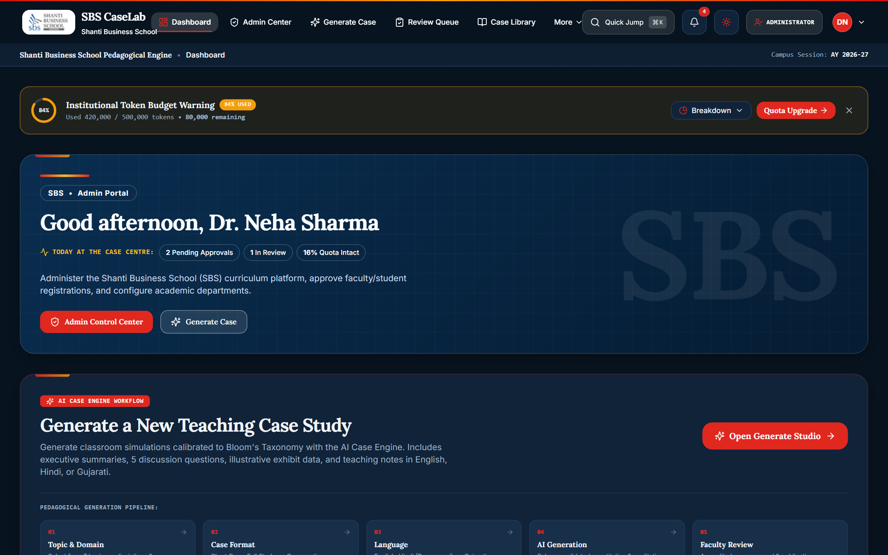
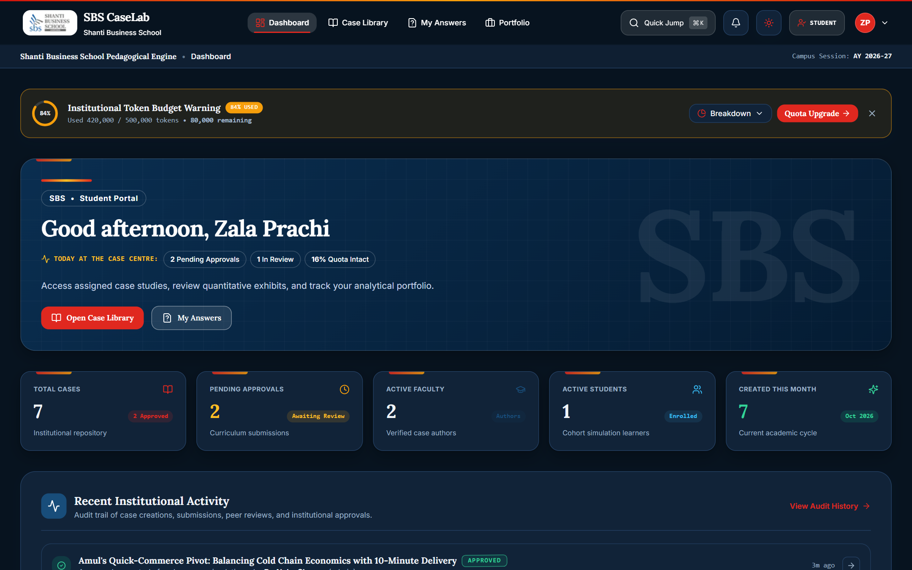
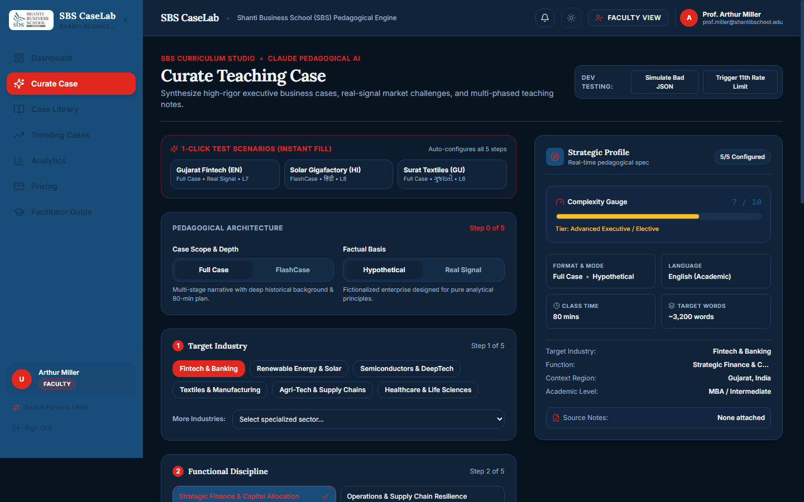
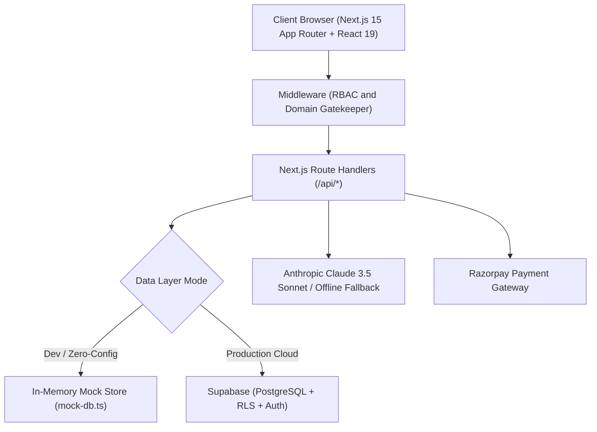

# 🏛️ SBS CaseLab — AI Case Study & Curriculum Simulation Platform

[](https://nextjs.org/)
[](https://react.dev/)
[](https://www.typescriptlang.org/)
[](https://tailwindcss.com/)
[](https://supabase.com/)
[](https://www.anthropic.com/)
[]()
[]()

> **Institutional Academic Platform for Shanti Business School (SBS)**  
> An enterprise-grade academic platform for generative AI business case synthesis, peer-reviewed curriculum publishing, Socratic live classroom simulations, two-tier AI evaluation, and NAAC/NBA accreditation analytics.

---

## 📑 Table of Contents

1. [Platform Overview](#-platform-overview)
2. [Visual Walkthrough](#-visual-walkthrough)
3. [Key Modules & Capabilities](#-key-modules--capabilities)
4. [Brand & Design System](#-brand--design-system)
5. [Architecture & Tech Stack](#-architecture--tech-stack)
6. [Quick Start & Setup](#-quick-start--setup)
7. [Environment Variables Reference](#-environment-variables-reference)
8. [Built-In Test Personas & Role Switcher](#-built-in-test-personas--role-switcher)
9. [Directory Structure](#-directory-structure)
10. [Database Schema & Migrations](#-database-schema--migrations)
11. [API Endpoints Reference](#-api-endpoints-reference)
12. [Available NPM Scripts](#-available-npm-scripts)
13. [Governance, Academic Integrity & DPDP Compliance](#-governance-academic-integrity--dpdp-compliance)
14. [Troubleshooting & FAQs](#-troubleshooting--faqs)
15. [Institutional Attribution](#-institutional-attribution)

---

## 🌟 Platform Overview

**SBS CaseLab** modernizes business school pedagogy by transforming static textbook case studies into dynamic, interactive, and accredited learning experiences. Specifically built for **Shanti Business School (SBS)**, the platform bridges classroom discussion with real-world industry dilemmas.

- 🏛️ **For Deans & Administrators**: Institutional oversight, review & approve curriculum cases, monitor token usage quotas, manage user access, export OBE curriculum attainment data, and enforce DPDP Act 2023 regulatory privacy rights.
- 👨‍🏫 **For Faculty**: Generate comprehensive 5-page case studies with realistic financial exhibits, teaching notes, and board plans in seconds using generative AI; submit cases to the review queue; track student mastery; and map rubrics to NAAC/NBA program outcomes.
- 🎓 **For Students**: Solve interactive real-world dilemmas, receive instant AI rubric grading, build a verified analytical portfolio, and earn downloadable certificates.

---

## 📸 Visual Walkthrough

| Admin Governance & Quotas | Faculty AI Studio & Management |
| :---: | :---: |
|  |  |

| Student Case Solver & Portfolio | 1-Click Persona Switcher |
| :---: | :---: |
|  |  |

| Case Library & Search | Generate Case & Financial Exhibits |
| :---: | :---: |
|  |  |

---

## 🚀 Key Modules & Capabilities

### 1. ✍️ Generative AI Case Studio (`/create`, `/faculty/curate`)
- **Multimodal Context Ingestion**: Upload syllabi, company annual reports, or industry whitepapers (`.pdf`, `.docx`, `.txt`) parsed via `pdf-parse` and `mammoth`.
- **Three Case Architectures**:
  - *Comprehensive 5-Page Case*: Executive narrative, dilemmas, multi-period financial tables, and strategic alternatives.
  - *FlashCase (Micro-Dilemma)*: Fast-paced 1-page situational puzzle for cold-call warmups.
  - *Real Signals*: Converts breaking industry news into immediate classroom case dilemmas.
- **Multilingual Support**: Synthesizes authentic Indian business cases in **English**, **Hindi (हिंदी)**, and **Gujarati (ગુજરાતી)** with full Unicode rendering.
- **Streaming & Offline Fallback**: Real-time server-sent streaming using Anthropic Claude 3.5 Sonnet, with an intelligent built-in offline simulation mode for local development without API keys.

### 2. 📊 Interactive Financial Exhibits (`InteractiveFinancialExhibit.tsx`)
- Dynamic, interactive financial models embedded into case studies.
- Supports editable revenue growth rates, COGS sensitivity sliders, and automated recalculation of Gross Profit, Operating Margin, and EBITDA.
- Switch between tabular views and dynamic visual chart projections.

### 3. ⚖️ Peer-Review & Version Control Workflow (`/review-queue`)
- **Review Pipeline**: Multi-stage approval lifecycle (`Draft` ➔ `In Review` ➔ `Changes Requested` ➔ `Approved` ➔ `Published`).
- **Immutable Version Snapshots**: Complete version history capturing timestamped revisions, diffs, and reviewer commentary.
- **Departmental Isolation**: Fine-grained access control ensuring students only access approved cases within their enrolled academic disciplines.

### 4. 🏛️ Live Socratic Classroom & Media (`/cases/[id]/live`)
- **Digital 3-Board Layout**: Synchronized facilitator dashboard for tracking Protagonists & Dilemmas, Strategic Options, and Final Action Plans.
- **Interactive Cold Calling**: Random or strategic student selection with instant rubric scoring during live sessions.
- **Real-Time Polls**: Engage student cohorts in live strategic voting scenarios with instant percentage breakdown.
- **Executive Audio Briefs ("CasePods")**: Audio summaries synthesized with multi-speaker dialogues for auditory learning and executive review.
- **Alumni Practitioner Reflections**: Real-world practitioner insights from industry alumni with community upvoting.

### 5. 🎓 Student Experience & Two-Tier AI Grading (`/student`, `/portfolio`)
- **Strategic Case Solver**: Timed submission workspace with integrated exhibit references and guided rubric criteria.
- **Speech-to-Text Voice Dictation**: Integrated voice dictation button allowing students to articulate complex qualitative arguments verbally.
- **Two-Tier Evaluation Engine**:
  - **Tier 1 (Instant AI Evaluation)**: Detailed criterion-level scoring, feedback, and improvement suggestions generated automatically.
  - **Tier 2 (Faculty Moderation & Release)**: Faculty can override, annotate, and finalize grades before publishing to students.
- **Submission Integrity Tracking**: Analyzes drafting duration, paste frequency, and editing patterns for academic integrity audits.
- **Analytical Portfolio & Certificates**: Public or private portfolio showcase featuring earned credentials and printable PDF Certificates of Mastery.

### 6. 📊 NAAC / NBA Curriculum Accreditation (`/analytics`)
- **Outcome-Based Education (OBE)**: Maps case evaluation rubrics to Course Outcomes (`CO1`–`CO5`) and Program Outcomes (`PO1`–`PO5`).
- **Real-Time Attainment Matrix**: Calculates aggregate institutional attainment scores against target thresholds.
- **One-Click CSV Export**: Pre-formatted data export with UTF-8 BOM ready for direct submission to NAAC / NBA accreditation committees.

### 7. ⌨️ Global Command Palette (`Ctrl+K` / `Cmd+K`)
- Omnipresent quick navigation and universal search.
- Search across case studies, courses, departments, and execute administrative actions instantly.

### 8. 💳 Alumni Continuing Education & DPDP Compliance (`/pricing`, `/admin`)
- **Alumni Subscription Engine**: Tiered alumni access powered by Razorpay test payment integration.
- **DPDP Act 2023 Compliance**:
  - User Data Portability (one-click JSON data export).
  - Right to be Forgotten (complete user account and activity anonymization/erasure).
  - Transparent consent logging and immutable system audit trails.
- **Institutional Token Budget Engine**:
  - Accurate Groq API usage tracking: counts `prompt_tokens`, `completion_tokens`, and `total_tokens` directly from Groq responses (bypassing per-minute rate-limit headers).
  - 500,000 monthly token limit with configurable thresholds (`WARN_AT=80`, `CRITICAL_AT=95`).
  - Warning banner with SVG progress ring, monospace telemetry, model/feature breakdown drawer, and 100% budget blocking.

---

## 🎨 Brand & Design System

The platform reflects the institutional legacy and academic prestige of **Shanti Business School (SBS)**:

| Element | Design Token | Description |
|---|---|---|
| **Primary Navy** | `#0A1128` / `#0E1A38` | Deep institutional navy for sidebars, headers, and primary accents |
| **Academic Gold** | `#C5A059` / `#D4AF37` | Academic distinction accent for badges, ratings, and highlights |
| **Canvas (Light)**| `#FBF9F5` | Warm parchment off-white for high reading comfort |
| **Canvas (Dark)** | `#0B0F17` | Deep slate canvas with persistence via `localStorage` and `class="dark"` |
| **Typography** | `Lora` / `Georgia` + `Inter` | Classical serif headings paired with clean, modern sans-serif body text |

---

## 🛠️ Architecture & Tech Stack



- **Frontend Framework**: [Next.js 15](https://nextjs.org/) (App Router, Server Actions, Server Components)
- **UI Library & Styling**: [React 19](https://react.dev/), [Tailwind CSS](https://tailwindcss.com/), [Lucide React](https://lucide.dev/)
- **Document Export**: `jspdf` (PDF reports & certificates), `docx` (Word case study export)
- **Document Ingestion**: `mammoth` (Word document parsing), `pdf-parse` (PDF text extraction)
- **Authentication & Database**: [Supabase](https://supabase.com/) (SSR Auth, PostgreSQL with Row-Level Security)
- **AI Synthesis**: [Anthropic Claude SDK](https://www.anthropic.com/) (`@anthropic-ai/sdk`)
- **Testing & Tooling**: TypeScript 5.8, ESLint 9, `tsx`, Puppeteer

---

## ⚡ Quick Start & Setup

### 1. Prerequisites
- **Node.js**: v18.17+ or v20+ (tested on Node v20 & v22)
- **npm**: v9+ (packaged with Node.js)

Verify your environment:
```bash
node -v
npm -v
```

---

### 2. Installation
Clone or extract the repository, then install project dependencies:
```bash
npm install
```

---

### 3. Environment Configuration
Copy `.env.example` to create your `.env.local` configuration:

**Windows (PowerShell):**
```powershell
Copy-Item .env.example .env.local
```

**Windows (Command Prompt):**
```cmd
copy .env.example .env.local
```

**macOS / Linux:**
```bash
cp .env.example .env.local
```

> [!NOTE]
> **Zero External Setup Required**: The application includes an in-memory singleton database (`src/lib/mock-db.ts`) and offline AI fallback. It runs completely out-of-the-box without requiring live Supabase or Anthropic credentials!

---

### 4. Run the Development Server
```bash
npm run dev
```

Open your browser and visit:  
👉 **`http://localhost:3000`**

---

## ⚙️ Environment Variables Reference

| Variable | Required | Default / Example | Purpose |
|---|:---:|---|---|
| `NEXT_PUBLIC_APP_NAME` | No | `"SBS CaseLab"` | Display name shown throughout the application |
| `NEXT_PUBLIC_COLLEGE_NAME` | No | `"Shanti Business School"` | Full institutional name |
| `NEXT_PUBLIC_COLLEGE_SHORT` | No | `"SBS"` | Short acronym for badges and compact headers |
| `NEXT_PUBLIC_COLLEGE_EMAIL_DOMAIN` | No | `"shantibschool.edu.in"` | Mandatory email domain for user registration |
| `NEXT_PUBLIC_ENABLE_DEMO_MODE` | No | `"true"` | Enables 1-click Persona Switcher in dev environments |
| `SESSION_SECRET` | Yes | `"sbs_caselab_secure_session_..."` | Key used for encrypting session cookies |
| `DEMO_USER_PASSWORD` | No | `"SBS_SecurePassword2026!"` | Default password for seeded accounts (if not set, random generated) |
| `REQUIRE_ADMIN_APPROVAL` | No | `"true"` | Enforces admin verification before accounts can author or access cases |
| `ACCESS_DURATION_MONTHS` | No | `"12"` | Grace period duration in months after batch graduation |
| `REVIEW_REMINDER_DAYS` | No | `"3"` | Days before an assigned peer review is flagged overdue |
| `WORDS_PER_PAGE` | No | `"500"` | Standard academic budgeting ratio for page calculations |
| `ENROLLMENT_REGEX` | No | `"^SBS\\/[0-9]{4}\\/[0-9]{4}$"` | Validation regex for student enrollment numbers (e.g. `SBS/2024/0001`) |
| `EMPLOYEE_ID_REGEX` | No | `"^SBS\\/FAC\\/[0-9]{3,4}$"` | Validation regex for faculty employee IDs (e.g. `SBS/FAC/101`) |
| `FEATURE_STUDENT_ANSWERS` | No | `"false"` | Flag preserving student case answering workspace |
| `FEATURE_CERTIFICATES` | No | `"false"` | Flag preserving student PDF certificate generation |
| `FEATURE_PORTFOLIO` | No | `"false"` | Flag preserving student analytical portfolio |
| `FEATURE_OBE_ANALYTICS` | No | `"false"` | Flag preserving NAAC / NBA OBE accreditation matrix |
| `PAYMENTS_ENABLED` | No | `"false"` | Flag gating commercial alumni subscriptions and repository monetization |
| `PAID_DOWNLOADS` | No | `"false"` | Flag gating pay-per-download for alumni and external readers |
| `DEFAULT_CREATOR_SHARE_PCT` | No | `"60"` | Creator royalty share percentage for commercial case purchases |
| `ALUMNI_ANNUAL_PRICE_INR` | No | `"2999"` | Annual subscription price in INR for alumni repository access |
| `ALLOWED_EXTERNAL_COLLEGE_DOMAINS` | No | `""` | Comma-separated list of approved partner university domains |
| `NEXT_PUBLIC_SUPABASE_URL` | Prod | `"https://your-id.supabase.co"` | Supabase instance URL (optional in dev) |
| `NEXT_PUBLIC_SUPABASE_ANON_KEY` | Prod | `"eyJhbGci..."` | Supabase anonymous public key |
| `SUPABASE_SERVICE_ROLE_KEY` | Prod | `"eyJhbGci..."` | Supabase privileged service-role key |
| `GROQ_API_KEY` | No | `"gsk_..."` | Groq AI SDK key (server-only; simulated fallback if blank) |
| `TOKEN_BUDGET` | No | `500000` | Monthly institutional token allocation limit |
| `WARN_AT` | No | `80` | Warning banner percentage threshold (80-94% orange state) |
| `CRITICAL_AT` | No | `95` | Critical alert percentage threshold (95%+ red state) |
| `NEXT_PUBLIC_QUOTA_UPGRADE_URL` | No | `"/pricing"` | Destination link for Quota Upgrade button |
| `ANTHROPIC_API_KEY` | No | `"sk-ant-..."` | Claude API key (simulated offline mode used if blank) |
| `NEXT_PUBLIC_RAZORPAY_KEY_ID` | No | `"rzp_test_..."` | Razorpay key ID for alumni subscriptions |
| `RAZORPAY_KEY_SECRET` | No | `"test_secret_..."` | Razorpay secret for signature validation |
| `DEMO_PAYMENTS` | No | `"false"` | Simulate payments without contacting payment gateway |

---

## 👥 Built-In Test Personas & Role Switcher

When running locally in development mode (`NODE_ENV !== "production"` or `NEXT_PUBLIC_ENABLE_DEMO_MODE="true"`), a **Persona Switcher** is accessible directly in the top navigation profile dropdown and login page for instant authentication without password entry. If logging in via standard credentials, seed demo accounts utilize the password configured via the `DEMO_USER_PASSWORD` environment variable (or one-time generated secure credentials printed during `npm run seed`).

### Institutional Roles & Hierarchy
The platform enforces exactly three core database roles:
1. **`admin`**: System administrator and dean-level governance. Exactly one admin account exists, created solely via seed or server-side provisioning. The sign-up API strictly blocks and rejects any registration with an `admin` role.
2. **`faculty`**: Academic faculty members eligible to draft case studies, review student submissions, and participate in peer review.
3. **`student`**: Enrolled students who can author student-led cases, submit cases for faculty review, and access published cases in the institutional repository.

> **Reviewer Designation**: Reviewer is **NOT** a database role. It is a boolean administrative capability flag on faculty (`is_reviewer: true`), displayed in the interface as **"Faculty Member and Reviewer"**. Reviewers cannot be unassigned if they currently have pending assigned reviews.

### Access Lifecycle & Expiration Gating
- **Access Start Date**: Set automatically on the day of institutional admin approval (calculated in `Asia/Kolkata` timezone).
- **Student Access End Date**: Calculated as `batch.end_date + 1 year` (e.g. Batch 2024–27 ends 30 June 2027; access extends through 30 June 2028). Students enjoy free platform access throughout their studies plus one full grace year.
- **Faculty & Admin Access End Date**: Perpetual (`null` / no expiration date) unless administratively revoked.
- **Account Expiration Lifecycle**: A daily cron job (`/api/cron/access-expiration`) marks expired accounts. Expired users retain perpetual login access, personal DPDP exports, and the right to view and download their own past submissions via `/expired`, but are strictly barred from creating new cases, submitting, or uploading to the repository until access is renewed.
- **Dual Login**: Registered users can authenticate using either their primary institutional `@shantibschool.edu.in` email or their verified external personal email address.

| Role | Persona Name | Institutional Email | Academic Details | Key Permissions |
|---|---|---|---|---|
| **Administrator** | Dr. Neha Sharma | `admin@shantibschool.edu.in` | Dean / Institutional Governance | Case approval, user & role management, lookup lists, token budgets, DPDP compliance, audit logs |
| **Faculty Member & Reviewer** | Ms. Reena Paswan | `reena.paswan@shantibschool.edu.in` | Department: BCA/IT • Course: BCA • Full-time | Case Studio authoring, teaching notes, peer review queue (`is_reviewer=true`) |
| **Faculty Member & Reviewer** | Dr. Vikram Mehta | `vikram.mehta@shantibschool.edu.in` | Department: Finance • Course: PGDM • Full-time | Case authoring, financial exhibits, peer review queue (`is_reviewer=true`) |
| **Student** | Zala Prachi | `prachi.z24bca@shantibschool.edu.in` | BCA • Batch: 2024–27 • Roll: 01 • Enr: `SBS/2024/0001` | Case creation, submit for review, repository search, clean case downloads |

---

## 📂 Directory Structure

```text
Case_Study/
├── public/                 # Static assets, branding logos, and screenshot previews
│   ├── sbs-logo.png
│   ├── sbs-corporate-logo.png
│   └── screenshots/        # High-resolution UI captures (dark/light mode)
├── scripts/                # Database seeding & automated acceptance tests
│   ├── seed.ts             # Seeds 1 Admin, 2 Faculty, 10 Students, courses & cases
│   └── test-acceptance.ts  # End-to-end acceptance verification suite (34 test cases)
├── src/
│   ├── app/                # Next.js 15 App Router pages & API routes
│   │   ├── (auth)/         # Login, registration, role switcher
│   │   ├── admin/          # Governance, user management, audit logs
│   │   ├── analytics/      # NAAC / NBA OBE curriculum attainment matrix
│   │   ├── api/            # Serverless route handlers (AI, auth, cases, grades)
│   │   ├── cases/          # Case viewer, live Socratic classroom, exports
│   │   ├── create/         # Generative AI Case Studio & exhibit editor
│   │   ├── dashboard/      # Role-based dashboard (Admin/Faculty/Student)
│   │   ├── library/        # Searchable repository and custom collections
│   │   ├── portfolio/      # Student analytical showcase & certificates
│   │   ├── pricing/        # Alumni continuing education subscriptions
│   │   └── review-queue/   # Peer-review queue for curriculum approval
│   ├── components/         # Reusable UI component library & layout wrappers
│   │   ├── AppShell.tsx                    # Main navigation shell with responsive drawer
│   │   ├── CommandPalette.tsx              # Global search and keyboard shortcuts (Ctrl+K)
│   │   ├── InteractiveFinancialExhibit.tsx # Dynamic P&L / balance sheet modeling
│   │   ├── AudioBriefPlayer.tsx            # Multi-speaker executive audio summaries
│   │   ├── VoiceDictationButton.tsx        # Speech-to-text dictation component
│   │   └── NotificationDropdown.tsx        # Real-time alert centre
│   ├── config/             # Institutional branding constants (college.ts, theme.ts)
│   └── lib/                # Data stores, session auth, Claude SDK, error tracking
│       ├── mock-db.ts      # Zero-dependency in-memory data store
│       ├── claude.ts       # Anthropic AI streaming & prompt templates
│       ├── session.ts      # Cookie session encryption & verification
│       └── supabase/       # Supabase SSR client & server configurations
└── supabase/
    └── migrations/         # Production-ready PostgreSQL DDL & RLS policies
```

---

## 🗄️ Database Schema & Migrations

For production deployment with a live Supabase PostgreSQL database, the repository includes 16 sequential migrations in `supabase/migrations/`. 

> [!WARNING]
> **AUTOMATIC DEPLOYMENT & CI/CD NOTICE**: If this repository is connected to automatic deployment (such as Vercel, Netlify, or AWS Amplify), **the database migrations (particularly `00015` and `00016`) MUST be applied to your Supabase project in the Supabase SQL Editor BEFORE pushing to `main` or initiating a deployment build**. Running the build without applying the migrations may lead to database schema mismatch or runtime authorization errors.

### Complete List of Database Migrations (In Execution Order)

| # | Migration File | Scope & Capabilities Added |
|---|---|---|
| 1 | `00001_initial_schema.sql` | Base `profiles`, `departments`, `courses`, `cases`, `usage_log`, and initial RLS policies. |
| 2 | `00002_library_approval_versions.sql` | `case_versions`, `collections`, `collection_cases`, and reviewer capability flags. |
| 3 | `00003_student_experience_rubrics_grades.sql` | `rubrics`, `rubric_criteria`, `student_answers`, `grades`, and student portfolios. |
| 4 | `00004_outcomes_signals_analytics.sql` | `outcomes` (CO/PO), `case_outcomes`, `signals` radar, and faculty watchlists. |
| 5 | `00005_live_classroom_integrity_reflections.sql` | `classroom_sessions`, `audio_briefs`, `integrity_reports`, and practitioner notes. |
| 6 | `00006_subscriptions_audit_dpdp.sql` | `subscriptions`, `audit_logs`, and DPDP Act 2023 compliance handlers. |
| 7 | `00007_update_college_domain_and_name.sql` | Institutional branding and `@shantibschool.edu.in` identity migration. |
| 8 | `00008_update_email_domain_to_edu_in.sql` | Domain constraints and email normalization rules. |
| 9 | `00009_free_usage_and_external_users.sql` | External user tiering, guest exploration quotas, and rate limiting. |
| 10 | `00010_database_upgrade.sql` | Comprehensive column migrations, foreign keys, and RLS policy consolidation. |
| 11 | `00011_rls_security_tests.sql` | Automated pgTAP / SQL validation tests for RLS policy boundaries. |
| 12 | `00012_ce_casepack.sql` | Continuing Education (CE) CasePack metadata, syllabus ingest, and feedback tables. |
| 13 | `00013_token_usage.sql` | Granular per-request token usage tracking, prompts, and audit records. |
| 14 | `00014_dpdp_consent_versioning.sql` | DPDP statutory consent version tracking (`consent_version`, `consent_at`). |
| 15 | `00015_case_repository_schema.sql` | **Lookup tables**: `batches`, `faculty_types`, `case_categories`, `case_types`.<br>**Institutional profiles**: `personal_email`, `mobile`, `enrollment_no`, `roll_no`, `batch_id`, `faculty_type_id`, `access_start`, `access_end`, `access_status`.<br>**Repository workflow**: `review_rounds`, `review_comments`, `reviewer_rotation`, `repository_items`, `download_log`.<br>**Integrity checks**: Indian mobile regex, email domain checks, admin perpetual access. |
| 16 | `00016_case_repository_rls_functions.sql` | **Functions & RLS**: `assign_reviewer(case_id)` atomic rotation with row lock (`FOR UPDATE`), `prevent_self_role_change()` trigger, strict RLS for peer reviews and repository items, and `student_repository_cases` secure view stripping model answer keys and teaching notes at the database level. |

### How to Apply Migrations
1. Open your **Supabase Dashboard** -> **SQL Editor**.
2. Run the migration files in sequential order from `00001_...` through `00016_...`.
3. Alternatively, if using the Supabase CLI:
   ```bash
   npx supabase login
   npx supabase link --project-ref <your-project-id>
   npx supabase db push
   ```

### How to Seed the Database
To populate lookup tables (`departments`, `courses`, `batches`, `faculty_types`, `categories`, `case_types`), default admin, faculty reviewers, sample students, and repository cases:
```bash
npm run seed
```
*(Seed script generates credentials from `DEMO_USER_PASSWORD` or creates secure random passwords and prints them once. It refuses to run against production without an explicit confirmation flag).*

---

## 🔌 API Endpoints Reference

| Endpoint | Method | Description |
|---|:---:|---|
| `/api/auth` | `POST` | Authenticate (dual-login with SBS or personal email), sign up, OTP requests, or switch personas |
| `/api/lookup` | `GET` | Retrieve active academic lookup options (departments, courses, batches, faculty types, categories) |
| `/api/cases` | `GET`, `POST` | Fetch case library or draft new case studies with lookup attributes and page targets |
| `/api/cases/[id]/review-comments` | `GET`, `POST` | Fetch or record granular section-level review feedback in the Review Drawer |
| `/api/cases/[id]/upload` | `POST` | Institutional Upload Gate (strictly gates approved cases, checks author consent, publishes to repository) |
| `/api/repository` | `GET` | Faceted search across published repository items (department, course, category, query) |
| `/api/repository/download` | `GET` | Permissioned case downloads (students receive scrubbed clean copy; faculty receive teaching notes) |
| `/api/review-queue` | `GET`, `POST` | Peer-review queue for assigned faculty reviewers |
| `/api/admin` | `GET`, `POST` | Dean/Admin telemetry dashboard, reviewer toggling, reviewer reassignment, access renewal |
| `/api/admin/academic-lists` | `GET`, `POST` | Academic list CRUD (departments, courses, batches, faculty types, categories) with audit logging |
| `/api/admin/pending-registrations` | `GET`, `POST` | Single and bulk approval/rejection of pending student and faculty registrations |
| `/api/cron/access-expiration` | `GET`, `POST` | Daily scheduled cron to mark expired accounts, compute alumni transitions, and issue reminders |
| `/api/user/data-export` | `GET` | Export personal user data in JSON format (DPDP Act 2023) |
| `/api/user/data-delete` | `POST` | Exercise Right to Erasure / account anonymization (DPDP Act 2023) |
| `/api/user/consent-withdraw` | `POST` | Revoke DPDP statutory consent |
| `/api/payments/razorpay/order` | `POST` | Create order for alumni subscription |
| `/api/payments/razorpay/verify` | `POST` | Verify cryptographic signature and activate subscription |

---

## 📜 Available NPM Scripts

| Command | Description |
|---|---|
| `npm run dev` | Starts the Next.js development server at `http://localhost:3000` |
| `npm run build` | Compiles and validates the production build (TypeScript + linting) |
| `npm run start` | Boots the compiled production server |
| `npm run lint` | Runs Next.js ESLint verification |
| `npm run seed` | Executes `scripts/seed.ts` to reset & seed initial database records |
| `npm test` | Runs acceptance tests (`scripts/test-acceptance.ts`, 41 verified assertions) |
| `npm run test:smoke:p7` | **Phase 7 Production Smoke Test**: 20 checks for OTP security, DPDP consent, password policy, admin sign-up blocking, student RBAC isolation, answer key scrubbing, upload gate, and RLS policies |
| `npm run test:secret-scan` | Scans source code, scripts, and compiled `.next/` bundle for leaked secrets or hardcoded passwords |
| `npm run test:repository-rls` | Verifies Phase 1 repository schema, migrations 15 & 16, RLS policies, and student answer key privacy |
| `npm run test:auth` | Verifies Phase 2 role-based registration, Asia/Kolkata date math, dual login, and access gating |
| `npm run test:workflow` | Verifies Phase 3 case creation filters, page budget targets, affirmations, and review lifecycles |
| `npm run test:repository` | Verifies Phase 4 atomic reviewer rotation, section review comments, upload gate, and repository search |
| `npm run test:admin` | Verifies Phase 5 telemetry metrics, reviewer workloads, reassignment, and bulk batch renewals |

---

## 🛡️ Governance, Academic Integrity & DPDP Compliance

SBS CaseLab adheres to strict academic integrity standards and Indian data privacy regulations:

- **Institutional Domain Gatekeeping**: Email addresses are validated against `@shantibschool.edu.in` to prevent unauthorized external access.
- **Role-Based Access Control (RBAC)**: Enforced via `src/middleware.ts` to guard administrative, faculty, reviewer, and student routes.
- **Academic Integrity Engine**: Captures writing duration, paste bursts, and AI probability to ensure ethical student analysis.
- **DPDP Act 2023 Compliance**:
  - **Data Export (`/api/user/data-export`)**: Users can download a machine-readable JSON copy of all personal submissions, grades, and profile metadata.
  - **Right to Erasure (`/api/user/data-delete`)**: Immediate anonymization and purging of identifiable user records upon verified request.
  - **Right to Withdraw Consent (`/api/user/consent-withdraw`)**: Users can withdraw statutory consent anytime via `/privacy`.
  - **Comprehensive Audit Trails**: Timestamped tracking of all administrative role adjustments, quota modifications, and case status changes.

> ⚖️ **Legal Counsel Confirmation Required**: All statutory notices, consent disclosures, retention windows, and privacy policies in this repository are foundational compliance implementations under the Digital Personal Data Protection (DPDP) Act 2023 and must be formally verified and confirmed by the college's legal team before live production deployment.

---

## ❓ Troubleshooting & FAQs

<details>
<summary><b>1. Port 3000 is already in use</b></summary>

You can specify an alternate port when running the dev server:
```bash
npm run dev -- -p 3001
```
Or terminate the process occupying port 3000:
- **Windows**: `Stop-Process -Id (Get-NetTCPConnection -LocalPort 3000).OwningProcess -Force`
- **macOS/Linux**: `lsof -ti:3000 | xargs kill -9`
</details>

<details>
<summary><b>2. How to test real AI generation with Anthropic?</b></summary>

Provide a valid Anthropic API key in `.env.local`:
```env
ANTHROPIC_API_KEY="sk-ant-api03-..."
```
If this variable is blank or omitted, the application seamlessly uses the built-in simulated streaming engine, allowing full feature evaluation without incurring API costs.
</details>

<details>
<summary><b>3. Why did changes reset after restarting the server?</b></summary>

The default local development configuration uses an in-memory database store (`src/lib/mock-db.ts`) for zero-friction setup. To persist data across restarts, connect a Supabase project by configuring `NEXT_PUBLIC_SUPABASE_URL` and `SUPABASE_SERVICE_ROLE_KEY` in `.env.local` and executing `npx supabase db push`.
</details>

<details>
<summary><b>4. How to switch roles during testing?</b></summary>

Simply use the **Persona Switcher** pinned to the lower portion of the sidebar or the login page. In demo mode (`NEXT_PUBLIC_ENABLE_DEMO_MODE="true"`), you can switch between Admin, Faculty, Reviewer, and Student with one click.
</details>

---

## 🚀 Deployment Guide: Vercel + Supabase

### Step 1: Supabase Database Setup
1. Create a new project in the [Supabase Dashboard](https://supabase.com/dashboard).
2. Retrieve your **Project URL**, **Anon Public Key**, and **Service Role Key** under **Project Settings $\rightarrow$ API**.
3. Push all migration files sequentially using Supabase CLI or SQL Editor:
   ```bash
   supabase link --project-ref your-project-id
   supabase db push
   ```

### Step 2: Vercel Project Deployment
1. Import your GitHub repository to [Vercel](https://vercel.com).
2. Framework Preset: **Next.js**
3. Root Directory: `./`
4. Build Command: `npm run build`
5. Output Directory: `.next`

### Step 3: Configure Environment Variables in Vercel
Add the following production environment variables under **Project Settings $\rightarrow$ Environment Variables**:
- `NEXT_PUBLIC_APP_NAME`: `SBS CaseLab`
- `NEXT_PUBLIC_COLLEGE_NAME`: `Shanti Business School`
- `NEXT_PUBLIC_COLLEGE_SHORT`: `SBS`
- `NEXT_PUBLIC_COLLEGE_EMAIL_DOMAIN`: `shantibschool.edu.in`
- `NEXT_PUBLIC_SUPABASE_URL`: `https://<your-project>.supabase.co`
- `NEXT_PUBLIC_SUPABASE_ANON_KEY`: Supabase Public Anonymous API Key
- `SUPABASE_SERVICE_ROLE_KEY`: Supabase Service Role Secret Key

### Step 4: Configure Razorpay Webhooks
1. Open the [Razorpay Dashboard](https://dashboard.razorpay.com/) $\rightarrow$ **Settings $\rightarrow$ Webhooks**.
2. Add Webhook URL: `https://your-domain.vercel.app/api/webhooks/razorpay`.
3. Secret: Enter the same secret configured in `RAZORPAY_WEBHOOK_SECRET`.
4. Active Events: Select `payment.captured`, `order.paid`, `subscription.charged`.

### Step 5: Execute Initial Production Seed
Populate the production database with accredited departments, courses, and administrator accounts:
```bash
npm run seed
```

---

## 📋 Production Readiness Checklist

- [x] **Security & Domain Isolation**: Only verified institutional emails ending with `@shantibschool.edu.in` are allowed registration.
- [x] **Zero API Key Exposure**: Claude and Supabase Service Role keys are strictly kept server-side in `.env.local` / Vercel Environment Variables.
- [x] **HTTP Hardening**: Mandatory security headers (`X-Frame-Options: DENY`, `X-Content-Type-Options: nosniff`, `Referrer-Policy`, CSP) enforced on all routes.
- [x] **Rate Limiting**: Per-user sliding hourly rate limit (10 generations/hr) protects API keys from exhaustion.
- [x] **PostgreSQL Row Level Security (RLS)**: Cryptographically prevents cross-student answer reading and restricts unapproved cases.
- [x] **Audit Logging Ledger**: Immutable audit entries logged for role modifications, approvals, grade overrides, and data subject actions.
- [x] **Cryptographic Payment Verification**: HMAC-SHA256 signature verification active on order completion and webhook endpoints; invalid signatures rejected with HTTP 400.
- [x] **Alumni Perpetual Work Access**: Graduated students permanently keep free download access to their portfolio, answers, and certificates regardless of subscription status.
- [x] **DPDP Act 2023 Compliance**: Mandatory registration consent checkbox, machine-readable JSON data export (`/api/user/data-export`), and permanent account erasure (`/api/user/data-delete`).
- [x] **Institutional Token Budget Alerts**: Real-time quota calculation with automatic 80% warning banner across faculty workspaces.
- [x] **Document Extraction & Audio Synthesizer**: Native server-side parsing for PDF/DOCX and client-side speech synthesis audio briefing ("CasePod").
- [x] **Multilingual Pedagogical Fidelity**: Tested and verified support for English, Hindi (Devanagari), and Gujarati scripts.

---

## 🏛️ Institutional Attribution

Developed for **Shanti Business School (SBS)**  
*Nurturing Business Leaders Through Applied Academic Innovation*  
Ahmedabad, Gujarat, India • [shantibschool.edu.in](https://shantibschool.edu.in)
