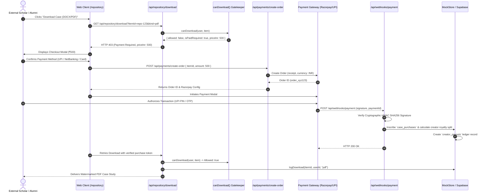

# SBS CaseLab: Commercialization, Creator Royalties & Subscriptions Architecture

> **Document Status**: Architectural Specification & Extension Blueprint (Phase 6)  
> **Operational Status**: **DORMANT / DISABLED** (`PAYMENTS_ENABLED=false`, `PAID_DOWNLOADS=false`)  
> **Institutional Scope**: Shanti Business School (SBS) Case Study Repository  
> **Target Release**: Phase 3 Extension / Post-Pilot Launch

---

## 1. Executive Summary

SBS CaseLab is designed primarily as an institutional academic case repository for Shanti Business School (SBS). During the current deployment phase (Phases 1 through 5), all core repository features—case generation, editorial review rounds, atomic reviewer rotation, and permissioned repository downloads—are 100% free for active institutional faculty and students.

This specification outlines the technical blueprint and extension architecture to activate:
1. **Commercial Single-Case Downloads** for external practitioners and guest scholars (e.g., ₹500/case).
2. **Creator Royalties & Payouts** splitting revenues between faculty/student authors and the institutional repository fund.
3. **Alumni Subscriptions** for former students whose 1-year free post-graduation grace period has elapsed.
4. **Partner College Federation** offering multi-seat campus licenses for partner business schools.

---

## 2. Pluggable Extension Points (Already Implemented in Core)

The repository schema, data models, and access control layer already contain clean extension points so that no breaking changes are required when payments are activated:

| Extension Point | File / Schema Location | Purpose & Implementation |
| :--- | :--- | :--- |
| **Price & Revenue Split** | `supabase/migrations/00015_case_repository_schema.sql`<br>`src/lib/types.ts` (`RepositoryItem`) | `price_inr numeric(10,2) null`<br>`creator_share_pct numeric(5,2) null` (defaults to 60%) |
| **Download Ledger** | `supabase/migrations/00015_case_repository_schema.sql`<br>`src/lib/types.ts` (`DownloadLog`) | Tracks every download event: `item_id`, `user_id`, `at`, `kind` (`pdf`/`docx`). Ready to bind to purchase receipts. |
| **Download Gatekeeper** | `src/lib/access-control.ts`<br>`canDownload(user, item)` | Evaluates active status, author self-download rights, and flags `isPaidRequired: true` when `PAYMENTS_ENABLED=true`. |
| **Partner College Domains** | `src/config/college.ts`<br>`ALLOWED_EXTERNAL_COLLEGE_DOMAINS` | Reserved config array and `isExternalCollegeDomain()` validator for partner university federation. |
| **Subscription Driven Status** | `src/lib/types.ts` (`AccessStatus`) | `access_status`: `"pending" \| "active" \| "expired" \| "inactive"`. `active` and `expired` are designed to be driven by subscription webhooks. |

---

## 3. Commercial Single-Case Downloads

### 3.1 Commercial Workflow & Pricing
When `PAYMENTS_ENABLED="true"` and `PAID_DOWNLOADS="true"`:
- **Standard Teaching Case Price**: ₹500 (inclusive of 18% GST).
- **Executive / Comprehensive Case Price**: ₹1,200.
- **Student Version**: Sanitized download (excludes Teaching Notes and Model Answer Keys).
- **Faculty / Instructor Version**: Master download (requires verified faculty credentials from an authorized institution).



### 3.2 Revenue Split Formula
Each commercial case download generates revenue split according to `repository_items.creator_share_pct` (default: 60% creator, 40% institution):

$$\text{Gross Transaction Amount} = ₹500.00$$
$$\text{GST (18\% Forward Charge)} = ₹76.27$$
$$\text{Net Distributable Base} = ₹423.73$$
$$\text{Creator Royalty (60\%)} = ₹254.24$$
$$\text{Institutional Repository Fund (40\%)} = ₹169.49$$

---

## 4. Creator Royalties & Automated Payout Engine

### 4.1 Proposed Payout Ledger Schema
```sql
CREATE TABLE IF NOT EXISTS creator_payouts (
    id UUID PRIMARY KEY DEFAULT gen_random_uuid(),
    author_id UUID NOT NULL REFERENCES profiles(id) ON DELETE RESTRICT,
    item_id UUID NOT NULL REFERENCES repository_items(id) ON DELETE RESTRICT,
    purchase_id UUID NOT NULL REFERENCES case_purchases(id) ON DELETE CASCADE,
    gross_share_inr NUMERIC(10,2) NOT NULL,
    tds_deducted_inr NUMERIC(10,2) NOT NULL DEFAULT 0.00,
    net_payout_inr NUMERIC(10,2) NOT NULL,
    payout_status TEXT NOT NULL DEFAULT 'pending' CHECK (payout_status IN ('pending', 'processing', 'completed', 'failed')),
    payout_batch_id TEXT NULL,
    bank_account_last4 TEXT NULL,
    transaction_utr TEXT NULL,
    created_at TIMESTAMPTZ NOT NULL DEFAULT timezone('utc', now()),
    paid_at TIMESTAMPTZ NULL
);

CREATE INDEX IF NOT EXISTS idx_payouts_author_status ON creator_payouts(author_id, payout_status);
```

### 4.2 Indian Statutory Compliance
1. **TDS under Section 194J (Income Tax Act)**:
   - 10% TDS deducted on professional royalty payments to resident individuals exceeding ₹30,000 in a financial year.
   - Requires verified PAN collection during author creator onboarding.
2. **GST Compliance**:
   - Platform issues automated B2C or B2B tax invoices with SAC Code `998431` (Online Educational Content Services).
   - Invoices include institutional GSTIN (`24AAAAA0000A1Z5` placeholder).
3. **Automated Batch Payouts**:
   - Monthly settlement on the 5th of every month for balances exceeding the minimum payout threshold (₹1,000).
   - Payout integration via Razorpay Route / Cashfree Payouts API using IMPS/NEFT.

---

## 5. Alumni Subscriptions (Post-Grace Period Access)

### 5.1 Grace Period Lifecycle
- **Active Student Period**: Free and unrestricted access during degree tenure.
- **Post-Graduation Grace Window**: Student retains 100% free access for exactly **1 year** following the official cohort batch completion date:
  $$\text{access\_end} = \text{batch.end\_date} + 1\text{ year}$$
- **Post-Grace Transition**:
  - The daily cron job (`/api/cron/access-expiration`) evaluates `access_end < now()` and transitions `access_status` to `"expired"`.
  - Account remains intact; user can log in with verified personal email.
  - User retains **perpetual free download access to their own past submissions** via `/expired`.
  - General repository downloads and case generation require an Alumni Subscription.

### 5.2 Subscription Plans & Pricing
| Plan Name | Duration | Target Audience | Annual Fee (INR) | Features Included |
| :--- | :--- | :--- | :--- | :--- |
| **Alumni Standard** | 12 Months | Former SBS Students | ₹2,999 / year | Full case repository read & download access (sanitized student/practitioner copies), alumni reflections. |
| **Alumni Scholar** | 12 Months | Alumni in Academia / Ph.D. | ₹4,999 / year | Full repository access + Teaching Notes eligibility upon verification of academic affiliation. |
| **Life Member** | Perpetual | Distinguished Alumni / Patrons | ₹24,999 one-time | Perpetual repository access, verified community upvoting rights, priority case curation. |

### 5.3 Webhook Subscription Lifecycle
When an alumni subscribes:
1. Razorpay Subscription / UPI AutoPay webhook triggers `/api/webhooks/razorpay`.
2. Verifies cryptographic signature using `RAZORPAY_WEBHOOK_SECRET`.
3. Inscribes subscription record in `subscriptions` table.
4. Updates user profile:
   ```typescript
   p.access_status = "active";
   p.access_end = new Date(Date.now() + 365 * 24 * 3600 * 1000).toISOString();
   ```
5. Logs audit action `subscription_created`.

---

## 6. Multi-Institutional Partner College Federation

### 6.1 Multi-Campus Licensing
For partner business schools wishing to adopt the SBS CaseLab repository for classroom pedagogy:
- **Partner College Whitelisting**: Partner domain registered in `src/config/college.ts` (`ALLOWED_EXTERNAL_COLLEGE_DOMAINS` or DB table `partner_colleges`).
- **Campus License Tier**:
  - **Tier A (Up to 500 students)**: ₹1,50,000 / academic year.
  - **Tier B (Up to 1,500 students)**: ₹3,50,000 / academic year.
  - **Tier C (University Enterprise)**: Custom enterprise agreement.
- **Security Isolation**:
  - Students of partner colleges only receive student-mode cases (strictly sanitized).
  - Partner faculty undergo institutional Dean-to-Dean verification before being authorized to access Teaching Notes and Model Answer Keys.

---

## 7. Configuration Checklist (When Activating Payments)

To transition from Phase 6 blueprint to live production payments in the future, configure the following environment variables:

```bash
# 1. Enable Payment Processing
PAYMENTS_ENABLED="true"
PAID_DOWNLOADS="true"

# 2. Royalty Split Defaults
DEFAULT_CREATOR_SHARE_PCT="60"
MIN_CREATOR_PAYOUT_THRESHOLD_INR="1000"

# 3. Alumni Pricing
ALUMNI_ANNUAL_PRICE_INR="2999"

# 4. Gateway Production Credentials (Server Only)
RAZORPAY_KEY_ID="rzp_live_xxxxxxxxxxxxxx"
RAZORPAY_KEY_SECRET="your_live_key_secret"
RAZORPAY_WEBHOOK_SECRET="your_live_webhook_secret"

# 5. Partner College Domains
EXTERNAL_COLLEGE_DOMAINS="partneruniv.edu.in,somaiyabusiness.edu.in"
```

---

## 8. Summary of Non-Breaking Guarantees
1. `PAYMENTS_ENABLED=false` keeps all current institutional features 100% free for SBS faculty and students.
2. `canDownload()` defaults to allowing all active internal institutional accounts.
3. No external payment calls or live payment webhooks will execute until `PAYMENTS_ENABLED` is flipped to `true`.
4. Authors retain perpetual ownership, credit, and self-download rights regardless of payment or subscription status.
